# 家常账 · 开发技术文档

版本：1.0 · 开发基线稿  
日期：2026-10-15  
适用范围：第一版响应式 Web；个人与家庭费用、待办、报表、票据识别及主动 AI 分析。

## 1. 文档定位与决策状态

本文是后续开发的主入口，包含功能规则、工程结构、数据模型、接口契约、流程、部署及验收。需求与第一版 UI 已确认；用户已确认采用一个项目仓库、前后端分目录、各自构建运行、统一部署管理。

Vue 3／NestJS／PostgreSQL 等组合沿用技术路线主推方案，作为本文实施设计基线；此前并未逐项明确确认具体技术组件。第三方微信渠道、实际云服务器与域名、备份目标位置仍未确认，不视为已开通或已接通。当前 M0—M5 核心代码已实现，M6 发布验收仍有外部环境依赖；代码完成度与未验收项以第 13、16 节为准。

| 项目                             | 状态         | 开发处理                                       |
| -------------------------------- | ------------ | ---------------------------------------------- |
| 功能及权限规则、第一版 UI        | 已确认       | 依据本文实现，不自行缩减                       |
| 默认个人、手机使用适配 Web       | 已确认       | 应用启动使用个人空间，不从旧会话自动恢复为家庭 |
| 一个 Monorepo、前后端独立目录    | 已确认       | 见第 3 节                                      |
| 云服务器优先、NAS 可迁移         | 已确认方向   | 见第 14 节，具体环境待填                       |
| DeepSeek 类外部 API              | 已表达偏好   | 供应商接口可替换，真实图片样本仍须验证         |
| Vue／NestJS／PostgreSQL 技术组合 | 本文主推基线 | 组件组合版本在搭建时固定并核验                 |
| 第三方微信通知及外发摘要         | 待确认       | 使用适配器与禁用配置，不伪造发送成功           |
| 服务器区域、配置、域名、备份位置 | 待确认       | 不阻塞本地工程设计；阻塞生产部署验收           |

阅读顺序：功能与权限（第 2 节）→ 工程及数据（第 3—5 节）→ 业务流程（第 6—9 节）→ API 与页面（第 10—12 节）→ 实施部署验收（第 13—16 节）。原型图见第 12 节。

## 2. 功能范围与不可变规则

### 2.1 首版功能清单

| 模块     | 实现内容                                                           | 不可变规则                                                                   |
| -------- | ------------------------------------------------------------------ | ---------------------------------------------------------------------------- |
| 账号     | 登录、首次改密、昵称、修改密码、管理员创建／重置／停用／恢复       | 无自助注册；用户名唯一且不可改；初始系统管理员用户名 admin，无默认密码       |
| 家庭     | 创建、完整用户名添加现有账号、退出／移除、管理权交接、归档／恢复   | 每账号最多一个当前家庭；家庭创建者为管理员；系统管理员不自动获得家庭数据权限 |
| 支出     | 名称、统一分类、日期、金额、可选数量／单位／单价／备注／凭证       | 付款人只能是当前账号；每笔仅一份记录、一个归属，无代记                       |
| 退款     | 选择原支出、部分／多次退款、独立编辑／删除                         | 累计不超原金额；不算收入；按实际退款日期统计                                 |
| 回收站   | 删除即时移出统计、30 天内恢复、到期清理                            | 仅本人且仍有写入权可恢复；原支出关联退款一起隐藏／恢复                       |
| 普通待办 | 个人／家庭、截止日期、可选负责人、完成／重开                       | 家庭全体当前成员提醒，一人完成即整体完成；编辑等由管理人执行                 |
| 固定费用 | 每月／每年、预计金额、周期暂停／恢复、生成每期事项、跳过／付款     | 确认付款才入账；确认人即付款人；同一期最多一笔有效付款                       |
| 提醒     | 站内消息、接收设置、微信适配入口、摘要及投递状态                   | 用户离开／停用／家庭归档立即影响后续投递，不补历史骚扰                       |
| 报表     | 日月年、支出／退款／净支出、趋势、分类、成员付款、同进度比较、明细 | 个人默认本人全部付款含家庭；家庭只看家庭归属，二者不可相加                   |
| 票据 AI  | 拍照／上传、主动识别、分类建议、核对、逐项归属、新建或补凭证       | 草稿不入账；混合票据原图始终私有；补凭证不改变原金额                         |
| 分析 AI  | 当前范围主动生成、变化／依据／待核对、历史与删除                   | 只发送汇总白名单，结果私有，不改账、不自动刷新                               |
| 访客分享 | 汇总快照、期限、可选口令、撤销、失效管理                           | 无逐笔／成员姓名／票据／AI；个人本人分享，家庭仅管理员分享                   |
| 系统管理 | 分类与账号 AI 每日额度                                             | 分类统一，历史分类可查；管理员不能代改他人账目                               |

首版不实现收入、结余、预算、欠款结算、比例分摊、银行同步、多币种、导入导出、公开注册、邀请链接、微信登录、语音／文字记账、独立手机 App、离线记账、每周／自定义周期、购买 AI 次数、永久账号或家庭删除。运维备份不属于面向用户的导出功能。

### 2.2 分类与数据输入

分类种子：餐饮、日用、住房、水费、电费、燃气费、交通、医疗、教育、娱乐、服饰、通讯、其他。水费、电费、燃气费分别统计，使用同一套可选数量／单位字段，不设计专属抄表、计费周期或用量分析模块。

支出金额大于零，两位小数；退款金额大于零。金额数据库使用 BIGINT 分；JSON 使用元的十进制字符串，例如 `"128.50"`，不使用浮点数相加。数量与单价使用 DECIMAL，提交总额是最终依据，数量乘单价只是填写辅助，折扣／抹零允许人工修正。

技术输入约定：名称 1—100 字，备注／待办说明最多 2000 字；数量为可选正数，最多 6 位小数，单位最多 20 字；单价为可选非负数、最多 6 位小数。金额最大 `999999999.99` 元。上述是接口校验边界，并非新增业务能力。非法或越界输入返回字段错误，不截断或自动取绝对值。

### 2.3 权限决策表

所有请求先检查会话、账号启用状态，再检查资源归属和操作；家庭归档／退出限制优先于角色。系统管理员只有账号、分类与额度管理权限，不具备全量账目查询接口。

| 资源／操作                     | 本人或管理人                     | 当前其他家庭成员 | 家庭管理员     | 访客       |
| ------------------------------ | -------------------------------- | ---------------- | -------------- | ---------- |
| 个人账目／任务                 | 本人读写                         | 不可见           | 不可见         | 不可见     |
| 家庭账目读取                   | 当前成员；离开后仅本人历史       | 可读             | 可读           | 不含明细   |
| 家庭账目修改／退款／删除／恢复 | 付款人且仍为当前成员、家庭未归档 | 不可             | 不可代改       | 不可       |
| 家庭普通任务完成               | 当前成员                         | 当前成员         | 当前成员       | 不可       |
| 家庭普通任务编辑／删除／重开   | 当前管理人；初始为创建者         | 不可             | 仅接管后可管理 | 不可       |
| 固定费用规则／跳过             | 当前管理人                       | 不可             | 仅接管后可管理 | 不可       |
| 固定费用付款                   | 当前成员本人确认                 | 当前成员本人确认 | 同成员         | 不可       |
| 原家庭 AI 历史                 | 仅发起人且权限未失效             | 不可             | 无额外权       | 不可       |
| 家庭成员、交接及归档           | 当前家庭管理员                   | 不可             | 可，受约束     | 不可       |
| 个人分享                       | 本人创建管理                     | 不可             | 无额外权       | 有效时只读 |
| 家庭分享                       | 当前管理员管理本人分享           | 不可             | 可创建本人分享 | 有效时只读 |

家庭管理员暂按一个现任管理员建模，交接后原管理员成为成员；至少一名有效系统管理员保留。系统管理员角色与家庭角色独立。

### 2.4 离开、停用、归档

- 离开家庭：历史家庭账保留；本人付款可在个人账本读取且只读；其他成员记录与原家庭 AI 历史不可访问；未完成家庭待办及固定费用管理权交管理员，付款人不变。
- 停用账号：撤销会话、停止提醒、保留历史，未完成家庭待办及固定费用同样交接；恢复不自动收回管理权。家庭管理员必须先交接才能被停用。
- 已完成任务不交接，离开／停用的原创建者不能因此越权重开；恢复账号仍遵循当前成员关系。
- 家庭归档：所有家庭写入冻结，包括退款、恢复、成员增减和待办操作；个人功能不受影响；停止家庭提醒、撤销分享。只有当前管理员可恢复家庭。
- 恢复家庭：保留既有事项，未来周期从恢复后的下一期继续，不补归档期；恢复期与临时数据清理时钟不暂停；旧分享不复活。

## 3. 技术架构与工程结构

### 3.1 技术选择

| 部分     | 选择                                       | 实施边界                                                                 |
| -------- | ------------------------------------------ | ------------------------------------------------------------------------ |
| 前端     | Vue 3、TypeScript、Vite、Vue Router、Pinia | Composition API；自有 UI 变量和业务组件；不引入整套后台模板替换已确认 UI |
| 图表     | Apache ECharts                             | 按需导入；支持负数、响应式和表格替代内容                                 |
| 服务端   | NestJS、TypeScript、REST                   | 模块化单体；API 与 worker 共用业务服务，各自进程启动                     |
| 数据库   | PostgreSQL 18 系列作为基线                 | 事务、外键、检查约束、部分唯一索引、行锁                                 |
| 数据访问 | Prisma                                     | 迁移必须保留原生 SQL 约束；复杂聚合／锁定用参数化 SQL                    |
| 运行时   | Node.js 24 LTS 作为基线、pnpm workspace    | 启动开发时锁定补丁版本与 packageManager；不用浮动 latest 发布            |
| 会话     | PostgreSQL 会话表 + Cookie                 | 无 JWT 长期权限缓存；重置／停用可即时撤销                                |
| 后台任务 | PostgreSQL 任务表 + Nest 定时扫描          | 独立 worker、租约和去重；首版不额外部署 Redis                            |
| 文件     | 私有持久化目录 + StoragePort               | 接口授权后读取，未来可换对象存储                                         |
| 外部服务 | AiProviderPort、NotificationProviderPort   | 正式与假实现分别配置，生产禁止无提示假成功                               |
| 部署     | Docker Compose、Nginx、TLS                 | 一个域名；前端静态资源与 `/api/v1` 同源                                  |

Node.js 与 PostgreSQL 支持状态在 2026-10-15 查询官方资料；框架补丁、Prisma 版本及系统镜像须在首个工程提交中做兼容性验证、固定并记录。迁移与客户端必须来自同一套锁定依赖，不套用其他大版本示例。

选择该结构是因为主要页面是登录后的交互应用，不依赖 SEO。前后端放在一个仓库，可同步调整契约；不需要 SSR、微服务、Kubernetes 或自托管模型。

### 3.2 Monorepo 目录

```text
HomeData/
├── apps/
│   ├── web/
│   │   ├── src/{app,router,stores,api,components,features,styles}/
│   │   └── tests/
│   └── server/
│       ├── src/
│       │   ├── main.ts                 API 启动入口
│       │   ├── worker.ts               后台任务入口
│       │   ├── modules/                业务模块
│       │   ├── shared/                 时钟、事务、授权、日志
│       │   └── adapters/               模型、通知、文件适配器
│       ├── prisma/{schema.prisma,migrations,seed.ts}
│       ├── cli/                        bootstrap-admin 等命令
│       └── tests/{unit,integration,e2e}/
├── packages/contracts/                 DTO Schema、错误码、枚举、接口类型
├── deploy/
│   ├── compose.yaml
│   ├── nginx.conf
│   ├── env.example
│   └── scripts/                        备份、恢复、检查
├── docs/
├── prototype/                          已确认的交互参考，不参与生产构建
├── pnpm-workspace.yaml
├── package.json
└── pnpm-lock.yaml
```

`contracts` 不包含数据库实体、密码或服务端密钥。前端可以用共用 Schema 提示字段问题，后端仍完整执行校验。服务端通过 DTO 显式输出字段，不把 ORM 查询对象原样返回。

模块划分：Auth、Accounts、Families、Ledger、Receipts、Tasks、Recurring、Reports、Notifications、Ai、Shares、Administration、Audit。控制器只接收／验证请求，业务服务执行授权与事务，查询服务统一报表口径，适配器不决定业务权限。

### 3.3 部署架构图

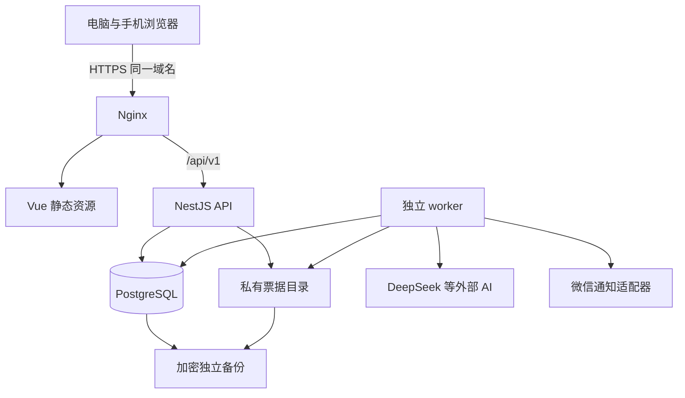

## 4. 全局技术约定

### 4.1 标识、日期及版本

- 主键使用 UUID；所有业务资源有 `created_at`、`updated_at`，可编辑聚合根有整数 `version`，提交修改携带当前版本，冲突返回 409，不覆盖他人刚保存的数据。
- 金额字段命名 `*_cents BIGINT`，API 命名 `amount` 等且用元字符串。数量 `DECIMAL(18,6)`，单价同精度，禁止把数据库 BigInt 直接 JSON 序列化为数字。
- 业务日期使用 DATE，时间戳使用 TIMESTAMPTZ；API 日期 `YYYY-MM-DD`、事件时间 ISO 8601。提醒与统计边界固定 `Asia/Shanghai`。
- 时间范围 API 为含首日、含末日；SQL 转成 `[from, to + 1天)`；不让浏览器本地时区改变消费日期。测试使用可注入 Clock。
- 对外错误不泄露其他家庭资源是否存在；不可见资源统一 404。已知本人资源操作冲突用明确业务码。

### 4.2 事务与并发

事务内：重新检查账号／家庭状态、锁定关键聚合根、校验业务限制、写数据、写审计、写 outbox，再提交。外部网络请求不得放在长事务中。

统一锁顺序：改变系统管理员角色或账号启用状态时先取得同一个系统管理保护锁（固定key的pg_advisory_xact_lock），在锁内统计有效管理员并更新，避免两个管理员并发停用彼此后归零；然后涉及家庭生命周期锁family，再按稳定ID顺序锁用户／成员，再锁具体业务聚合。退款先锁expense，周期付款先锁occurrence，付款删除恢复按occurrence → expense顺序，避免死锁；冲突仅对可重试事务有限重试。

接口幂等：创建支出、退款、批量票据确认、周期付款、AI 启动、分享创建等要求 `Idempotency-Key` UUID。服务端唯一键是 `(actor_id, operation, key)`，记录请求摘要、处理中状态及成功响应。相同键不同请求体返回 `IDEMPOTENCY_MISMATCH`；并发同键返回处理中，完成后可重放同一结果；网络失败后前端使用原键重试。建议保留 7 天，过期后的旧请求不得后台无限重试。

### 4.3 登录和输入保护

密码使用 Argon2id，按部署机器基准测试参数，最低采用 OWASP 推荐的可接受配置；密码不写日志。初始密码只在线下分配或管理员创建成功时一次显示；服务端不保存可逆明文。

技术默认：密码长度 12—128 字符；会话随机令牌至少 256 bit，仅存 SHA-256 摘要，7 天绝对有效期、24 小时空闲超时。生产 Cookie `__Host-hd_session; HttpOnly; Secure; SameSite=Lax; Path=/`，无 Domain。登录与改密轮换会话令牌，主动改密撤销其他会话；重置／停用撤销全部会话。首次改密会话仅可访问本人信息、改密和退出。

写入请求验证 Origin／CSRF 令牌；登录亦需来源检查。登录、口令验证、用户名添加、AI、上传分别限速；开发配置允许 localhost HTTP，生产不得因此关闭 Secure。生产仅允许配置的同源来源，不使用任意反射 CORS。

## 5. 数据模型与数据库约束

### 5.1 核心实体关系

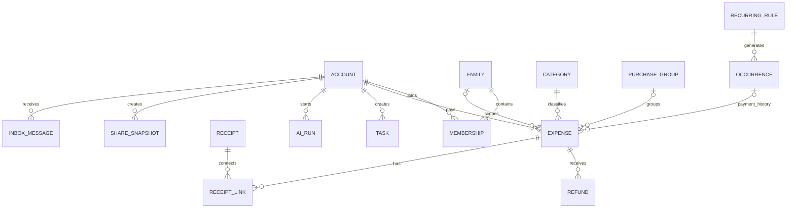

### 5.2 表结构字典

以下为应落实的逻辑表；所有业务 FK 默认 RESTRICT，清理使用受控事务。`?` 表示可空；JSONB 只能存经过 Schema 验证的指定结构，不能成为逃避字段设计的万能对象。

| 表                      | 核心字段                                                                                                                                                                                       | 约束与索引                                                                                                    |
| ----------------------- | ---------------------------------------------------------------------------------------------------------------------------------------------------------------------------------------------- | ------------------------------------------------------------------------------------------------------------- |
| accounts                | id, username, nickname, password_hash, system_role, status, must_change_password, auth_version                                                                                                 | username 规范化后唯一；`status=ACTIVE/DISABLED`；禁删最后有效系统管理员                                       |
| sessions                | id, account_id, token_hash, auth_version, created_at, last_seen_at, expires_at, revoked_at?                                                                                                    | token_hash 唯一；索引 account_id、expires_at；每次请求核对账号及版本                                          |
| families                | id, name, admin_account_id, status, archived_at?, version                                                                                                                                      | `status=ACTIVE/ARCHIVED`；管理员必须为该家庭当前有效成员，由事务保证                                          |
| memberships             | id, family_id, account_id, joined_at, left_at?, leave_reason?                                                                                                                                  | 当前 membership 以 left_at IS NULL 定义；一个账号最多一条当前关系；历史不覆盖                                 |
| categories              | id, code, name, is_active, sort_order                                                                                                                                                          | code 唯一稳定；水、电、燃气单独 code；历史 FK 不删                                                            |
| purchase_groups         | id, owner_id, source, occurred_on                                                                                                                                                              | 分组不保存可直接对外输出的原单总额；可见合计查询时计算                                                        |
| expenses                | id, payer_id, family_id?, category_id, title, occurred_on, amount_cents, quantity?, unit?, unit_price?, note?, group_id?, occurrence_id?, deleted_at?, purge_after?, delete_batch_id?, version | family_id 空即个人；金额正；索引 payer/date、family/date、category/date；周期有效付款部分唯一                 |
| refunds                 | id, expense_id, amount_cents, occurred_on, deleted_at?, purge_after?, delete_batch_id?, version                                                                                                | 分类、归属、付款人由原支出关联取得，不冗余可改；金额正；expense/date 索引                                     |
| receipts                | id, owner_id, storage_key, sha256, mime, bytes, width, height, state, privacy_lock, created_at, expires_at?, version                                                                           | storage_key 唯一；privacy_lock 一旦因混合为 PRIVATE 不得自动放宽；owner/hash 非唯一索引用于本人重复提示       |
| receipt_links           | id, receipt_id, expense_id, created_at                                                                                                                                                         | receipt+expense 唯一；不因一笔记录删除而清理其他引用                                                          |
| receipt_drafts          | id, owner_id, receipt_id, ai_run_id?, parsed_data, state, expires_at, confirmed_group_id?, version                                                                                             | 私有；7 天；确认只能成功一次，过期不可确认                                                                    |
| tasks                   | id, family_id?, creator_id, manager_id, manager_membership_id?, assignee_id?, title, description?, due_on, status, completed_by?, completed_at?, deleted_at?, version                          | `OPEN/DONE`；家庭管理权绑定对应加入关系；完成者必须是执行当时有权账号；索引 family/status/due、manager/status |
| recurring_rules         | id, family_id?, creator_id, manager_id, title, category_id, frequency, anchor_on, next_due_on, expected_cents?, status, schedule_revision, version                                             | MONTHLY/YEARLY；ACTIVE/PAUSED；保存原始日历锚点，不能用上次回落日期滚动                                       |
| recurring_rule_versions | id, rule_id, revision, effective_at, config                                                                                                                                                    | 记录未来规则与暂停／归档区间，用于漏生成补偿；rule+revision 唯一                                              |
| occurrences             | id, rule_id, period_key, due_on, title_snapshot, category_id_snapshot, expected_cents?, manager_id, status, active_expense_id?, generated_at, schedule_revision, version                       | rule+period_key 唯一；PENDING/PAID/SKIPPED；到期日等为生成时快照，后改规则不覆盖                              |
| reminder_preferences    | account_id, local_time, task_advance_days, fee_advance_days, overdue_enabled                                                                                                                   | 每人自己的接收时间，默认09:00、1、3、每日逾期；家庭对象仍全体成员                                             |
| reminder_overrides      | id, subject_type, subject_id, advance_days?, due_enabled?, overdue_enabled?                                                                                                                    | 可选事项级覆盖；无字段代表沿用接收设置，不缩小家庭提醒对象                                                    |
| inbox_messages          | id, recipient_id, slot_at, state, read_at?, frozen_at?, payload_version, created_at                                                                                                            | 同用户同时间槽唯一；站内持久化，已读与投递状态分开                                                            |
| inbox_items             | id, message_id, subject_type, subject_id, reminder_kind, scheduled_on                                                                                                                          | 去重键 recipient+subject+kind+业务日；读取内容再次授权，旧通知不泄露已无权限数据                              |
| notification_bindings   | id, account_id, provider, encrypted_credentials, key_id, state                                                                                                                                 | 当前启用绑定唯一；解绑撤销未来投递；密钥不能回传                                                              |
| deliveries              | id, message_id, binding_id, frozen_payload, payload_version, state, provider_message_id?, attempt_count, next_attempt_at?, last_error_code?                                                    | message+channel 唯一；PENDING/SUBMITTED/DELIVERED/FAILED/UNKNOWN/CANCELLED                                    |
| ai_limits               | account_id, recognition_limit, analysis_limit                                                                                                                                                  | 默认20／5；非负整数，系统管理员维护                                                                           |
| ai_daily_usage          | account_id, business_date, bucket, reserved, succeeded                                                                                                                                         | 三字段唯一；事务内预占，reserved+succeeded 不超过当次上限                                                     |
| ai_runs                 | id, requester_id, family_id?, membership_id?, kind, provider, model, status, input_ref?, result?, usage_date, quota_state, provider_usage?, error_code?, invalidated_at?, created_at           | RECEIPT/CLASSIFY/ANALYSIS；权限丧失后家庭分析标记不可恢复访问；私有结果                                       |
| share_snapshots         | id, owner_id, family_id?, token_hash, passcode_hash?, aggregate_payload, range, generated_at, expires_at, revoked_at?, invalidated_at?, purge_after?                                           | token_hash 唯一；仅白名单汇总；固定快照，失效不可逆                                                           |
| share_dependencies      | snapshot_id, family_id, membership_id?, required_role                                                                                                                                          | 记录快照涉及的家庭权限依赖；个人全部付款快照涉及家庭时亦登记，失权时同步失效                                  |
| share_access_sessions   | id, snapshot_id, token_hash, expires_at                                                                                                                                                        | 有口令解锁后的短会话；不能覆盖快照失效，Cookie 与用户登录分开                                                 |
| audit_events            | id, actor_id?, family_id?, resource_type, resource_id, action, safe_diff, occurred_at                                                                                                          | 事件不可改；查询跟随资源权限；不记录密码、图片正文、AI 密钥或跨隐私完整文本                                   |
| jobs                    | id, kind, dedupe_key, payload_ref, status, available_at, attempts, lease_owner?, lease_until?, last_error_code?                                                                                | dedupe_key 唯一；索引 status/available_at；不存明文供应商密钥                                                 |
| idempotency_records     | actor_id, operation, key, request_hash, status, response_json?, expires_at                                                                                                                     | 三字段唯一；响应不含长期密钥或口令明文                                                                        |

家庭任务的 `creator_id` 永久保留，`manager_id` 表示当前可编辑、重开和跳过的管理人。接管改变 manager，不改变 creator 或 payer。固定费用已生成的未完成期事项也需更新 manager，避免只交接规则遗漏本期。

### 5.3 必须落地的 SQL 约束

以下是迁移约束示例，字段名对应上表；正式迁移在 ORM 建表后执行，并通过数据库集成测试验证。

```sql
CREATE UNIQUE INDEX ux_one_current_family
  ON memberships(account_id) WHERE left_at IS NULL;
CREATE UNIQUE INDEX ux_current_member
  ON memberships(family_id, account_id) WHERE left_at IS NULL;
CREATE UNIQUE INDEX ux_active_occurrence_payment
  ON expenses(occurrence_id)
  WHERE occurrence_id IS NOT NULL AND deleted_at IS NULL;
CREATE UNIQUE INDEX ux_rule_period ON occurrences(rule_id, period_key);
ALTER TABLE expenses ADD CONSTRAINT ck_expense_amount
  CHECK (amount_cents > 0 AND amount_cents <= 99999999999);
ALTER TABLE refunds ADD CONSTRAINT ck_refund_amount
  CHECK (amount_cents > 0 AND amount_cents <= 99999999999);
ALTER TABLE ai_daily_usage ADD CONSTRAINT ck_ai_usage
  CHECK (reserved >= 0 AND succeeded >= 0);
```

退款累计、管理员有效性、家庭写入及状态联动属于跨行规则，必须由事务与行锁保证，不能以 CHECK 伪装已覆盖。`occurrences.active_expense_id` 与支出双向引用在迁移时分步创建；清理已删除支出时安全清空失效引用，不删除周期历史。

### 5.4 删除、恢复与文件生命周期

- 独立删除退款：仅该退款标记删除，记录自身恢复期限。删除原支出：生成 delete_batch_id，原支出及当时有效退款加入同一批次；早已单独删除的退款保持原批次和期限。
- 恢复原支出：仅恢复同一删除批次中未过期的退款，不复活此前独立删除的退款。独立恢复退款需要原支出有效且重算累计不超额；原支出删除时不可单独恢复其退款。
- 删除后 `purge_after=deleted_at+30天`，到期不可恢复，即使清理 job 尚未执行。清理以数据库时间检查；归档不延长期限。
- 图片由活动草稿、有效凭证引用或仍在恢复期的记录保护。7 天草稿过期只释放草稿引用，不删除已经正式保留的凭证。已删除但可恢复的支出仍保护其凭证。
- 用户移除一笔记录的凭证只移除该 link；其他 link 存在时保留文件。最后引用结束后由清理任务删除文件；失败可重试，storage_key 不复用，先防访问再做物理清理。
- 混合票据 privacy_lock 永久 PRIVATE，即使以后删掉个人条目，不能自动公开原图。纯家庭票据也必须同时满足当前家庭成员资格与对应记录可读；本人历史凭证另有只读授权。
- 原为纯家庭票据后续关联到个人或其他家庭记录时，服务端重新计算隐私并永久锁为PRIVATE，不能相信客户端提交的privacy字段来放宽；图片授权不等同于任一关联条目可读。
- 审计留最小操作元信息，不用审计快照变相永久保存已清理账目正文。删除支出前要处理关联退款与文件引用，不用数据库任意 CASCADE 擦除无关对象。

## 6. 账号、家庭与权限流程

### 6.1 登录与首次改密

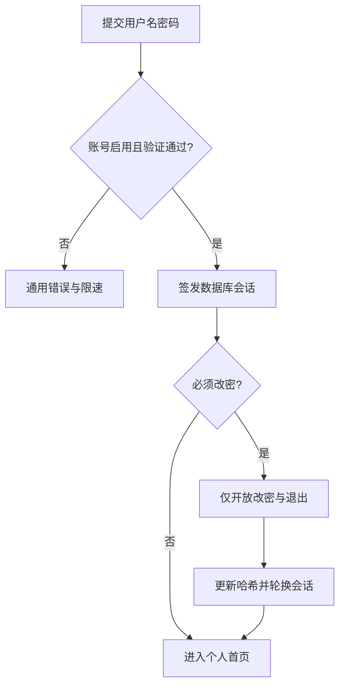

首个管理员通过 CLI 交互式输入初始密码创建；默认用户名 admin，仅在数据库不存在任何管理员时允许 bootstrap，重复运行返回已初始化，不打印密码到日志。

### 6.2 家庭成员变更

创建家庭事务：锁当前账号 → 核对无当前 membership → 创建 family 和会员关系 → 指定 admin。添加成员使用完整用户名，禁止模糊搜索返回账号列表；目标账号须启用、无当前家庭。

交接先确认目标是现有启用成员；事务修改 admin、失效原管理员家庭分享，再记录审计。退出／移除／停用需按第 2.4 节交接未完成内容，并取消待发通知、使分享及家庭分析访问失效。任何并发操作必须重新检查成员及家庭状态。

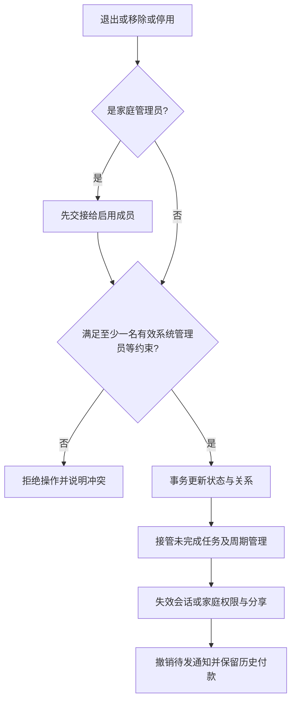

停用不等于退出：membership 可以保留，但账号状态限制优先；接管仍执行。成员重新加入形成新 membership，旧分析若已失效不因重新加入自动恢复。

家庭任务的编辑／删除／重开除manager_id匹配，还需manager_membership_id指向本人当前有效加入关系。未完成任务交接时同步改为接管人的关系；离家者已完成任务保留旧关系而不交接，后来重新加入也不会自动拿回旧任务重开权。个人任务不依赖家庭关系。

## 7. 账务、票据与报表流程

### 7.1 记账及退款

手动支出保存：会话有效 → 请求字段校验 → payer 强制取当前账号 → 核对所选家庭可写 → 金额转换分 → 幂等校验 → 事务保存与审计 → 返回 DTO → 刷新受影响报表。保存家庭支出不会自动切换当前页面空间。撤销保存调用删除接口，使用同一权限、30 天规则，UI 建议提供 6 秒撤销入口。

退款事务：锁原 expense → 重新检查有效、本人、未归档／未离开 → SUM 有效退款 → 校验新增／编辑后的总额 → 保存退款与审计。修改原金额同样加锁且不得低于退款总额；修改原分类／归属后退款通过关联即时跟随。

周期付款支出的归属受 occurrence 约束，不能编辑归属使家庭期付款变为个人支出；原金额、数量和备注仍可由付款人按权限编辑。若要纠正付款归属，删除误记并按正确业务重新记录，不静默解除关联。

### 7.2 票据核对流程

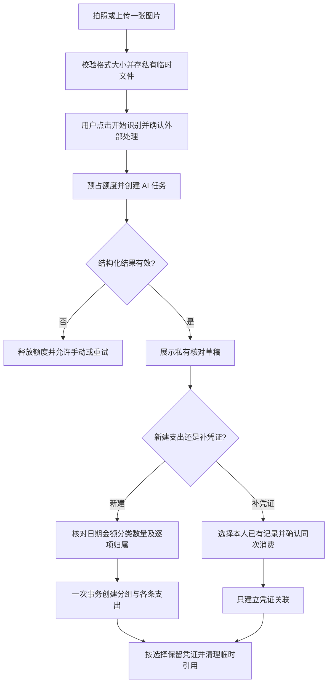

JPG／PNG／WebP，单张最多 10 MiB（10×1024×1024 字节），与界面“10 MB”提示一致。校验实际签名、解码、尺寸／像素上限并移除无用元信息；技术默认解码像素上限 4000 万，超出提示换图，不直接占满内存。模型侧缩放只影响推理输入，不以缩略图覆盖用户保留凭证。

核对要求：缺失或低确定字段明确展示；条目合计与识别总额不符显示差额，要求修改或主动确认差异；正式统计只累加最终条目，不再次加整单总额。疑似重复只查本人内容，提示后可继续，与网络幂等区别处理。

确认新建时可批量归属后逐项调整，事务全成功或全失败；本次保留凭证包含混合归属即永久私有。补凭证只允许本人当前可写记录，不改金额、不新增消费，原图含其他个人内容时仍私有。草稿确认成功后重试返回同一组记录，不再生成一组。

### 7.3 报表查询合同

统一过滤对象：`space=personal|family`、`familyId`（家庭时必填）、`origin=all|personal|family`（仅个人有效）、`from`、`to`、`basis=net|expense`、`granularity=day|month`。

个人查询条件始终 `payer_id=currentUser`，其中家庭归属包含本人历史家庭付款，当前无家庭不影响历史读取。家庭查询条件始终 `family_id=已授权当前家庭`。记录按日期选取，有效退款按退款发生日选取并关联有效原支出；不能要求原支出发生在同一时间窗才计退款。

查询服务复用同一个过滤器产生概览、分类、趋势、成员与明细。聚合按支出集和退款集分别汇总后合并，避免一笔支出连接多条退款导致支出被重复 SUM。

| 输出         | 公式与边界                                                   |
| ------------ | ------------------------------------------------------------ |
| 原始支出     | 期间有效支出金额之和                                         |
| 退款         | 期间有效退款金额之和，其原支出仍有效                         |
| 净支出       | 原始支出－退款，允许负值                                     |
| 分类         | 支出及退款都按原支出当前分类分组                             |
| 成员付款     | 按 payer 汇总，包含离开成员历史，不等于欠款或人均消费        |
| 购物分组合计 | 当前筛选和权限下的可见条目之和，禁止输出隐藏条目数量／原总额 |
| 空范围       | 明确 `hasData=false`，数值可为 0，但图表用空状态             |
| 负值分类     | 条形图，不用将负值截零的环图；负数不伪装为正占比             |

日比较对前一日；月比较对上月，未结束月截到相同日序且不超对照月末；年比较对上年同月同日，2/29 回落2/28。完整历史月／年比较完整上期。返回实际两组起止日期，让前端和 AI 使用同一结果。对照净额小于等于零时默认不展示增长百分比，仅展示差额，避免负基数语义误导；零基数必须不显示百分比。

统计示例：10 月支出100元、11月退款30元，则10月净支出100元、11月净支出−30元；原支出删除后两期同时移出，恢复后同时重计。

## 8. 待办、固定费用与可靠提醒

### 8.1 普通待办状态

普通任务：`OPEN → DONE` 由有权成员完成并记 completed_by；`DONE → OPEN` 仅当前管理人重开，清除当前完成字段、审计保留前次完成者。删除管理权同编辑。截止日只存日期，当天09:00是到期提醒，当天结束后才算逾期。

负责人是可选执行人，不决定提醒对象。负责人离家／停用后不再可选，未完成任务交接时清理无效负责人或改为接管人，保留审计。

### 8.2 固定费用的周期与付款

周期日历以 `anchor_on` 原始月日计算：每月31日的下一次不是从2月28日再加月，而是恢复到3月31日；年2月29日在平年2月28日。

period_key 对月为 `YYYY-MM`，对年为 `YYYY`，与 rule_id 唯一。最早接收人的提前提醒到达时生成一次 occurrence；创建规则时已进入提醒窗口则在下一次扫描生成；创建以前的期不追溯补建。成员新增、提醒提前天数变化不能重复生成同一期。

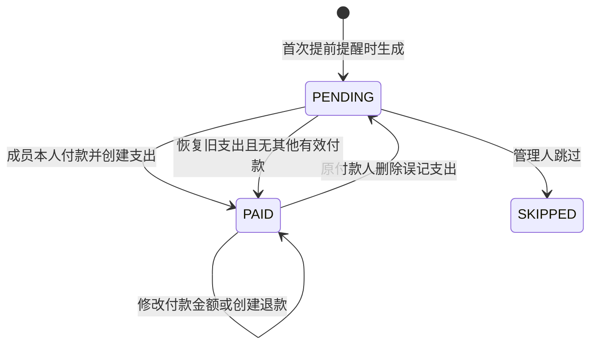

付款事务锁 occurrence → 检查仍 PENDING → 当前成员本人作为 payer 创建 expense → 写 active_expense_id 和 PAID → 取消本期待发提醒。数据库部分唯一索引是并发最后防线；同时付款的一方得到 `PERIOD_ALREADY_PAID` 并刷新实际付款人。

删除关联付款：锁 occurrence → 锁 expense → 有权本人删除支出及有效退款 → PENDING、清空 active_expense_id。恢复旧付款：同锁顺序，只有本期仍PENDING且无新有效付款才允许恢复并PAID；有新付款返回冲突，若已SKIPPED则返回PERIOD_SKIPPED，不能恢复旧记录来暗中撤销跳过。已付事项无独立重开接口；全额退款仍PAID。

规则变更只影响未生成事项，occurrence 快照不变。暂停只阻止生成新期，不删除已生成期及其有效提醒；恢复从下一期开始，不补暂停期间。家庭归档停止已有家庭事项提醒且暂停新期；恢复后已有事项继续，归档区间不补建。

系统停机不同于规则暂停：依据规则版本和活动区间扫描漏生成的活动期，保留真实应有的待处理期；站内可列出这些期，外发仅在当前有效提醒槽生成一次合并摘要，不逐日补发历史。

### 8.3 提醒生成、投递与去重

默认每人09:00北京时间，普通任务提前1天、固定费用提前3天、到期当天提醒；逾期未处理每天一次。每个接收人可以调整自己的时间和提前天数，事项级规则可覆盖提前／到期／逾期设置；不得把家庭接收范围改成仅负责人。

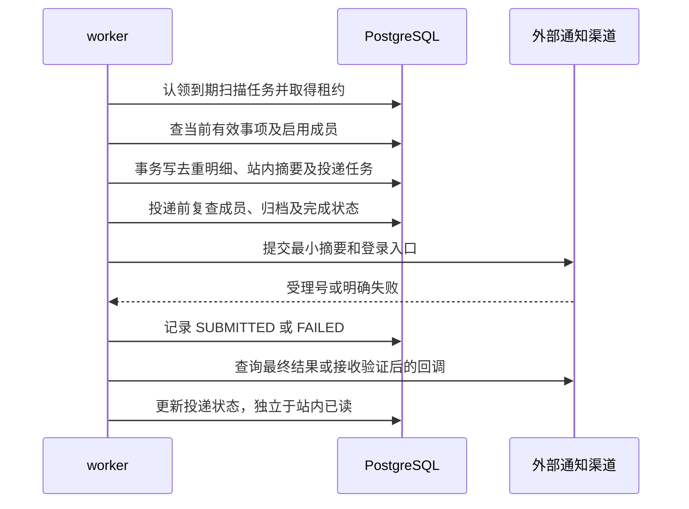

扫描间隔建议60秒；jobs 使用 `FOR UPDATE SKIP LOCKED` 批量认领、60秒租约、20秒心跳，失联后重领。家庭按当前启用成员逐个生成站内提醒；新成员只从加入以后接收当前仍有效的提醒，不回放加入前消息。

每个通知摘要只引用事项，读取详情重新授权。事项完成／归档／成员离开后，历史消息显示“已完成／不可访问”，不得继续返回无权限正文。外发前以剩余有效项重建摘要，空摘要取消。

时间槽外发前先完整扫描并事务汇总，再冻结payload_version与待发项集合；deliveries保存该版摘要。SUBMITTED之后不追加同批次内容、不修改已发版本；随后发现的新有效事项进入下一分钟的补偿槽，并沿用subject/kind/业务日去重，不能用原delivery成功状态声称新事项也已送达。失权或完成发生在冻结后、提交前时取消或缩减摘要并更新版本；提交后保留当时投递事实，读取站内消息仍按当前权限过滤。

技术默认重试：明确可重试失败在1、5、30分钟后最多3次；超过当前有效窗口、事项已处理或权限失效立即取消。限流按渠道退避，达到日额度停止当日尝试；永久凭证错误不重试并提示重新绑定。

请求超时但渠道可能已收件时标记 UNKNOWN，优先查询原流水，不盲目再次发送。渠道无法确认最终状态时如实展示“结果未知”；第三方无幂等时不能保证绝对不重复。站内摘要通过数据库唯一键保证只生成一次，不用外部投递失败补建一条站内消息。

## 9. AI 与访客分享

### 9.1 AI 供应商接口及额度

```typescript
interface AiProviderPort {
  extractReceipt(input: {
    image: Uint8Array;
    mime: string;
    categories: Array<{ id: string; name: string }>;
  }): Promise<ReceiptExtraction>;
  suggestCategory(input: CategorySuggestionInput): Promise<CategorySuggestion>;
  analyze(input: AggregateAnalysisInput): Promise<AnalysisResult>;
}
```

票据／单独分类使用 recognition 桶，默认每日20次；分析桶默认5次。两者均按北京时间业务日记录额度；附带分类的一次识别合计一次。事务原子预占 `reserved+1`，成功后 reserved−1 / succeeded+1，失败 reserved−1；同 run 重试不重复预占。跨午夜结束仍结算请求开始时的 usage_date，不扣新一天。

模型调用只来自用户明确创建的 ai_run；worker 仅执行该请求或有界失败重试，不自行生成分析。建议单次调用90秒超时、识别及分析各限制并发，最多2次瞬态重试，总超时和输出 token 上限可配置。队列等待取消不扣用户次数；已发生的供应商费用另记 provider_usage，失败不扣业务次数不意味着供应商免费。

worker调用前及结果落库／返回时重新核对账号和家庭访问权；运行途中失权的结果不得返回，标记取消并释放业务额度，已产生供应商费用仍如实记账。已失效的家庭分析不因重新加入恢复可读。

输入白名单：分析仅含 range、comparisonRange、expense、refund、net、分类 code／标准分类名称、各期汇总和证据 ID；不含用户名、昵称、成员ID／姓名、商家、条目名称、备注、原图或逐笔内容。证据 ID 指汇总指标，服务器保存其对应授权过滤条件，点击时重查明细。个人分析输入也只包含本人有权统计。

输出必须符合结构：`changes[]`、`evidence[]`、`thingsToVerify[]`；数值与区间由服务器绑定，模型不得自由改写金额。无数据／样本不足直接给确定性提示，是否创建 AI 请求由用户点击决定；不把未知原因描述成结论。模型输出按纯文本安全渲染，不接受可执行 HTML、SQL 或工具指令。

DeepSeek 为首选候选，视觉接口能力依据官方文档；实际模型名、数据处理条款、区域及图片识别准确率在接入前复核。未经明确告知，不自动切换另一供应商发送原图。

### 9.2 分享快照

创建者：个人本人，家庭当前管理员。服务器用统一报表查询服务生成白名单 aggregate_payload；不接受前端上传“已经脱敏”的任意快照。期限只能1／7／30天默认7，可选口令；生成256bit随机 token，仅保存其摘要，完整链接创建时返回一次。

口令采用密码哈希，不能放 URL；验证成功签发最多30分钟的独立访问会话，到期仍须受快照 expires_at 约束。访客接口每次校验快照期限、撤销、账号启用与相应家庭／管理员权限，设置 `Cache-Control: no-store`、`Referrer-Policy: no-referrer` 和禁止搜索索引。

快照不实时更新，返回生成时间、数据范围、失效时间及汇总。归档、停用、离家、交接失权都把 invalidated_at 落库，恢复权限不重置。失效时间取最早的过期／撤销／权限失效时刻，之后保留30天；管理查询仍检查当前权限，访客立即失效。公开失效页不透露账目或家庭详情。

个人“全部付款”快照若包含家庭费用，同步记录相关家庭依赖；涉及的家庭归档或分享者失去该家庭权限时撤销旧链接。本人仍可读历史付款，不代表原分享永久有效。家庭交接撤销依赖管理员角色的家庭分享，不因此撤销与该权限无关的纯个人分享。

## 10. REST API 契约

### 10.1 通用格式

前缀 `/api/v1`，除健康检查和明确 public 路由外均需登录。读取列表默认30条、上限100条，游标按 `(occurred_on,id)` 等稳定排序；`nextCursor=null` 表示结束。禁止把原始 SQL 排序字段直接插值。

```json
{
  "data": { "id": "uuid", "version": 1 },
  "meta": { "requestId": "uuid" }
}
```

```json
{
  "error": {
    "code": "REFUND_EXCEEDS_EXPENSE",
    "message": "累计退款不能超过原支出金额",
    "fields": { "amount": "超过当前可退款金额" },
    "retryable": false
  },
  "meta": { "requestId": "uuid" }
}
```

成功读取200、创建201、异步202、无响应内容204；输入422、未登录401、已知权限限制403、资源不可见404、状态冲突409、超限429、外部依赖暂不可用503。`version` 作为修改请求体必填字段，幂等头用于创建／动作；只读查询不要求幂等头。

### 10.2 账号、家庭、系统管理

| 方法与路径                              | 请求要点／结果                            | 权限与副作用                       |
| --------------------------------------- | ----------------------------------------- | ---------------------------------- |
| GET /auth/csrf                          | 返回 CSRF token                           | 不泄露会话；同源使用               |
| POST /auth/login                        | username,password → me,mustChangePassword | 登录限速、签发 Cookie              |
| POST /auth/logout                       | 无 →204                                   | 撤销当前会话                       |
| GET /me                                 | 本人 DTO、角色、当前家庭及有效能力        | 不返回 password_hash、token        |
| PATCH /me                               | nickname,version                          | 仅本人                             |
| POST /me/password                       | currentPassword,newPassword               | 首次改密亦需当前密码；轮换会话     |
| POST /families                          | name → family                             | 当前无家庭者创建                   |
| GET /families/current                   | 家庭与本人角色                            | 无家庭返回 data=null               |
| GET /families/:id/members               | 当前成员 DTO                              | 当前成员；不返回系统账号列表       |
| POST /families/:id/members              | username                                  | 管理员添加完整用户名               |
| POST /families/:id/leave                | version                                   | 当前成员，管理员先交接             |
| DELETE /families/:id/members/:accountId | version                                   | 管理员移除，执行交接和失效         |
| POST /families/:id/handover             | targetAccountId,version                   | 原管理员交权并撤销原分享           |
| POST /families/:id/archive              | version                                   | 冻结写入、停提醒、失效分享         |
| POST /families/:id/restore              | version                                   | 仅当前管理员，按下一期继续         |
| GET /categories                         | includeInactive                           | 历史显示停用项，新增只能选启用项   |
| GET/POST /admin/accounts                | 列表／username,nickname,initialPassword   | 系统管理员；创建不授予他人账目访问 |
| POST /admin/accounts/:id/reset-password | initialPassword                           | 撤销全部会话、强制改密             |
| POST /admin/accounts/:id/disable        | version                                   | 校验管理员约束并接管家庭未完成内容 |
| POST /admin/accounts/:id/enable         | version                                   | 恢复账号，不自动收回任务           |
| POST/PATCH /admin/categories[/:id]      | code,name,sortOrder,isActive              | 仅系统管理员；不提供物理删除       |
| GET/PATCH /admin/accounts/:id/ai-limits | recognitionLimit,analysisLimit            | 仅系统管理员                       |

### 10.3 支出、退款与票据

| 方法与路径                                 | 请求要点／结果                                    | 权限与副作用                                  |
| ------------------------------------------ | ------------------------------------------------- | --------------------------------------------- |
| GET /expenses                              | space,origin,from,to,categoryId,q,cursor,deleted  | personal 始终本人付款；q 只搜索授权集合       |
| POST /expenses                             | 第10.7节 DTO                                      | payer 从会话取，不接受他人字段                |
| GET/PATCH /expenses/:id                    | 详情／可修改字段,version                          | 家庭读写不同；只读历史返回 capabilities       |
| DELETE /expenses/:id                       | version                                           | 软删除、退款批次、周期联动                    |
| POST /expenses/:id/restore                 | version                                           | 30天内、有家庭写入权、无付款冲突              |
| POST /expenses/:id/refunds                 | amount,occurredOn                                 | 必须原记录，锁原支出核验累计                  |
| PATCH/DELETE /refunds/:id                  | amount,occurredOn,version／version                | 本人，同原支出权限                            |
| POST /refunds/:id/restore                  | version                                           | 原支出有效，累计再校验                        |
| GET /expenses/:id/audit                    | 简短操作历史                                      | 仅资源可读者，字段脱敏                        |
| POST /receipts/uploads                     | multipart image → receiptId,draftId               | 上传本身不触发 AI；单图10MiB                  |
| POST /receipt-drafts/:id/recognize         | externalProcessingConsent=true → runId            | 主动启动，预占额度；重复使用同幂等键          |
| GET/PATCH /receipt-drafts/:id              | 核对草稿／用户修改字段,version                    | 仅本人且未过期                                |
| POST /receipt-drafts/:id/confirm           | items[],keepReceipt,acknowledgeDifference,version | 一次事务新建分组和支出                        |
| POST /receipt-drafts/:id/attach            | expenseId,confirmSamePurchase,privacy,version     | 只建凭证引用，不改金额                        |
| POST /expenses/:id/receipt-links           | receiptId,confirmSamePurchase                     | 本人未经过 AI 的上传也可补凭证                |
| DELETE /expenses/:id/receipt-links/:linkId | version                                           | 删除关联，不删除其他消费                      |
| GET /receipts/:id/content                  | 二进制图片                                        | 每次鉴权，private/no-store，不返回storage_key |

禁用分类允许历史记录保留原分类；编辑其他字段不强迫换分类，但改选时必须选启用分类。已确认草稿再次 confirm 仅允许幂等返回同组，不允许不同请求生成第二组。

### 10.4 待办、周期及通知

| 方法与路径                              | 请求要点／结果                                                      | 权限与副作用                             |
| --------------------------------------- | ------------------------------------------------------------------- | ---------------------------------------- |
| GET/POST /tasks                         | 筛选／title,description,dueOn,familyId?,assigneeId?                 | 个人本人；家庭当前成员可新建             |
| GET/PATCH/DELETE /tasks/:id             | 详情／修改字段,version                                              | 修改删除仅manager；归档禁写              |
| POST /tasks/:id/complete                | version                                                             | 家庭当前成员均可，记录完成者             |
| POST /tasks/:id/reopen                  | version                                                             | 仅manager，后续提醒时段恢复              |
| GET/POST /recurring-rules               | 筛选／title,categoryId,frequency,anchorOn,expectedAmount?,familyId? | 初始manager=creator                      |
| GET/PATCH /recurring-rules/:id          | 详情／规则字段,version                                              | 仅manager，生成新规则版本                |
| POST /recurring-rules/:id/pause         | version                                                             | 仅manager，已有事项保留                  |
| POST /recurring-rules/:id/resume        | version                                                             | 仅manager，不补暂停期                    |
| GET /recurring-rules/:id/occurrences    | 各期状态、付款人、金额                                              | 当前有空间读取权                         |
| POST /occurrences/:id/pay               | amount,occurredOn,version                                           | 当前成员本人付款，同期唯一               |
| POST /occurrences/:id/skip              | version                                                             | 仅manager，PENDING可跳过                 |
| GET /notifications                      | cursor,unreadOnly                                                   | 仅本人，内容按当前权限再过滤             |
| POST /notifications/:id/read            | 无                                                                  | 只改变本人已读，不代表任务完成           |
| GET/PATCH /me/reminder-preferences      | localTime,taskAdvanceDays,feeAdvanceDays,overdueEnabled             | 本人接收设置，范围不变                   |
| GET /me/notification-bindings           | provider,state,maskedIdentifier                                     | 不返回令牌明文                           |
| POST /me/notification-bindings          | 渠道绑定参数                                                        | 最终参数待渠道核验，未启用返回明确不可用 |
| DELETE /me/notification-bindings/:id    | 无                                                                  | 解绑并取消未发投递                       |
| POST /me/notification-bindings/:id/test | 明确主动测试                                                        | 真实渠道启用后才提供，记录结果并限速     |

普通待办软删除后停止提醒，不扩展为支出回收站；是否增加普通任务恢复入口不属于首版范围。固定费用通过暂停和每期跳过管理，不提供直接删除历史周期配置的接口。

### 10.5 报表、AI 和分享

| 方法与路径                        | 请求要点／结果                             | 权限与副作用                       |
| --------------------------------- | ------------------------------------------ | ---------------------------------- |
| GET /dashboard                    | space,origin → 月净支出、最多3条近期事项   | 不返回完整图表或最近账单           |
| GET /reports/summary              | 统一范围 → expense,refund,net,comparison   | 服务器统一计算                     |
| GET /reports/trend                | 范围,granularity                           | 负值如实输出，空范围注明           |
| GET /reports/categories           | 范围,basis                                 | 分类ID、金额、对应明细过滤器       |
| GET /reports/members              | 家庭范围                                   | 仅家庭，有离开成员历史付款         |
| GET /reports/details              | 范围,categoryId?,payerId?,kind?,cursor     | 过滤权限与图表完全一致             |
| GET /ai/status                    | 是否启用、recognition／analysis限额         | 不泄露密钥                         |
| POST /ai/receipt-extractions      | receiptId → runId                          | 主动触发；原图私有，结果只是草稿   |
| POST /ai/analyses                 | 范围 → runId或确定性无数据结果              | 服务端生成汇总，不接受任意AI输入   |
| GET /ai/runs/:id                  | PENDING/RUNNING/SUCCEEDED/FAILED/CANCELLED  | 仅发起人；家庭结果绑定原成员关系   |
| GET/POST /shares                  | 本人管理／范围,expiresInDays,passcode?     | 家庭需管理员，payload由服务端生成  |
| GET /shares/:id                   | 本人有权管理的固定快照及状态               | 失效保留期内仍检查权限             |
| POST /shares/:id/revoke           | version                                    | 不可逆撤销                         |
| POST /public/shares/:token/unlock | passcode                                   | 限速，不记日志明文token            |
| GET /public/shares/:token         | 汇总快照或锁定／失效状态                   | 独立访问会话、每次校验，无成员明细 |
| GET /health/live                  | 简单存活                                   | 不返回环境与密钥                   |
| GET /health/ready                 | DB与迁移就绪                               | 依赖未就绪返回503                  |

生产 OpenAPI 由已锁定 DTO 生成，与本表对照验收；管理文档接口默认不公开公网。AI 未配置时明确 `AI_NOT_CONFIGURED`，站内普通功能照常；微信未启用不显示“绑定成功”。

### 10.6 关键错误码

`AUTH_REQUIRED`、`PASSWORD_CHANGE_REQUIRED`、`ACCOUNT_DISABLED`、`VERSION_CONFLICT`、`FAMILY_ARCHIVED`、`ALREADY_IN_FAMILY`、`ADMIN_HANDOVER_REQUIRED`、`LAST_SYSTEM_ADMIN`、`READ_ONLY_HISTORY`、`REFUND_EXCEEDS_EXPENSE`、`RESTORE_EXPIRED`、`PERIOD_ALREADY_PAID`、`PERIOD_SKIPPED`、`PERIOD_PAYMENT_SCOPE_LOCKED`、`RECEIPT_DRAFT_EXPIRED`、`RECEIPT_TOTAL_MISMATCH`、`AI_QUOTA_EXCEEDED`、`AI_NOT_CONFIGURED`、`PROVIDER_UNAVAILABLE`、`SHARE_INVALID`、`IDEMPOTENCY_MISMATCH`。错误码稳定，中文文案可改；不得用200包装失败。

### 10.7 典型请求与响应

创建家庭归属支出，`Idempotency-Key` 与 `X-CSRF-Token` 放请求头。没有 payerId 字段。

```json
{
  "title": "清洁用品",
  "categoryId": "uuid-category",
  "occurredOn": "2026-10-15",
  "amount": "89.90",
  "quantity": "3",
  "unit": "件",
  "familyId": "uuid-family",
  "note": ""
}
```

```json
{
  "data": {
    "id": "uuid-expense",
    "amount": "89.90",
    "scope": "FAMILY",
    "payer": { "id": "uuid-current-user", "nickname": "本人昵称" },
    "version": 1,
    "capabilities": { "canEdit": true, "canRefund": true, "canDelete": true }
  },
  "meta": { "requestId": "uuid-request" }
}
```

报表概览响应示例：

```json
{
  "data": {
    "space": "personal",
    "origin": "all",
    "from": "2026-10-01",
    "to": "2026-10-15",
    "expense": "200.00",
    "refund": "30.00",
    "net": "170.00",
    "hasData": true,
    "scopeLabel": "本人支付，含家庭费用",
    "comparison": {
      "from": "2026-09-01",
      "to": "2026-09-15",
      "net": "0.00",
      "difference": "170.00",
      "percent": null
    }
  }
}
```

## 11. 前端页面、交互及状态

### 11.1 路由与状态分工

| 路由                     | 页面与操作                                   |
| ------------------------ | -------------------------------------------- |
| /login、/change-password | 登录、首次强制改密                           |
| /home                    | 本月摘要、三个快捷入口、最多3项近期需处理    |
| /ledger                  | 账本、筛选、购物分组、详情与退款、回收站切换 |
| /tasks                   | 待办任务／固定费用二级页签、详情和每期付款   |
| /reports                 | 日月年、图表、明细、主动分析与分享           |
| /me                      | 账号、家庭、提醒、分享、按角色显示管理入口   |
| /receipts/:draftId       | 私有票据核对，可由首页和账本进入             |
| /analyses/:id            | 私有分析结果及证据明细                       |
| /s/:token                | 独立访客快照页，不显示应用导航               |

Pinia 保存当前会话摘要、当前页面空间和临时 UI 状态；接口查询缓存必须以 userId、space、familyId、origin、range 构成隔离键。退出／切换账号清空缓存；离家／停用／归档响应同步清理受影响数据。账务写入成功后失效所有相关概览、账本及报表查询，不只改当前列表金额。

默认个人是启动默认值，用户一次会话内主动切换家庭后可跨页沿用。切换空间不能静默丢失编辑表单；未保存时提示继续编辑或放弃。保存时按表单显式归属提交，不能使用提交瞬间变化后的全局空间。

### 11.2 关键交互约定

- 记账首屏金额、分类、名称；日期默认北京时间今天；数量／单位／单价／备注／凭证折叠；归属和可见性始终可见。
- “再记一笔”可沿用明确选择的分类／归属，清空金额、名称及凭证；“撤销”执行真实软删除，不只从当前页面隐藏。
- 普通写入等待服务器确认后显示成功；按钮提交中禁用，网络失败保留输入并用相同幂等键重试，不缓存为离线已保存。
- 图表金额和明细都来自服务器；前端格式化不重算业务总额。金额列右对齐，负数保留符号，不只靠颜色表示退款。
- 家庭任务显示完成者，周期付款显示实际付款人；历史只读展示原因和可用操作，不保留可点击却必失败的编辑入口。
- 图片识别、分类和分析均要按钮主动触发；路由进入、输入变化和页面轮询不能启动新的付费请求。轮询只读 run 状态，建议2秒起并退避，切页停止。
- 手机底部五导航，桌面侧栏；表单手机可用底部抽屉或全屏层，输入键盘不遮挡保存，安全区留白，焦点可见，弹窗锁焦点并可键盘关闭。
- 320、390、768、1440px 核验无页面横向溢出；表格在限定容器内滚动；点击目标建议至少44px；支持 prefers-reduced-motion。

### 11.3 UI 变量

背景 `#eeecea`；纸面 `#faf9f7`；辅助面 `#e4e1dd`；正文 `#333231`；次文字 `#68635e`；主操作 `#526349`。数字及拉丁使用本地 Bricolage Grotesque，中文使用 Microsoft YaHei／系统无衬线回退，字体许可证随产物保留。

字号13／16／22／40／76px，手机标题32、主金额44px；金额使用等宽数字特性。统一线条SVG；常规面不使用渐变、玻璃与重阴影。动效只做短暂 opacity／transform，不增加营销式滚动特效。

## 12. 已确认原型图与交互参考

以下为已制作原型的实际截图，展示数据为演示内容，截图日期不是生产业务日期。首页默认个人；生产登录、权限与外部服务必须重新实现。桌面与手机均采用相同的五个功能入口。

### 12.1 首页

桌面：首页只承担记录入口、月净支出及近期事项，不堆叠完整账本和报表。

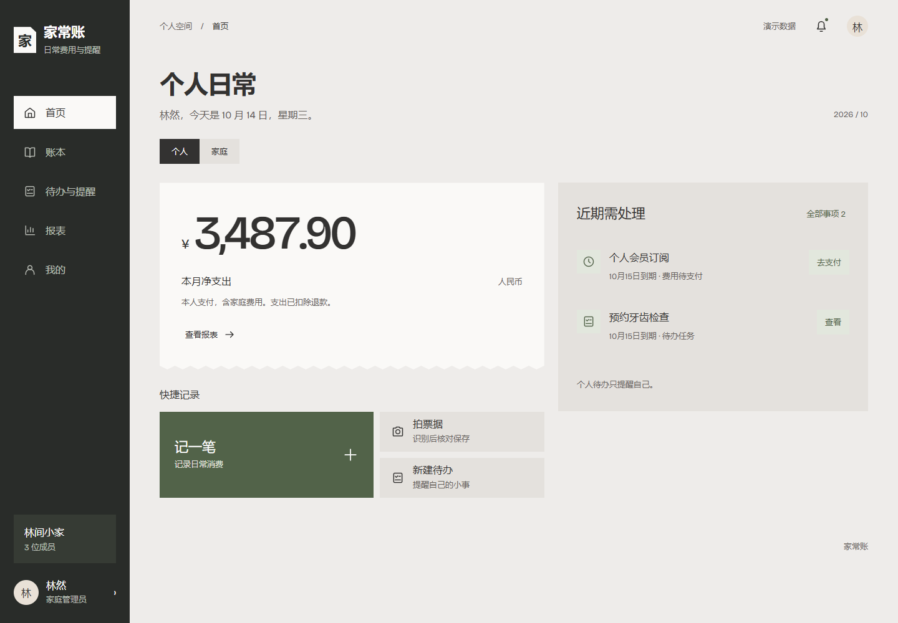

手机：摘要、记录、处理事项依次排列，底部导航保持可达。

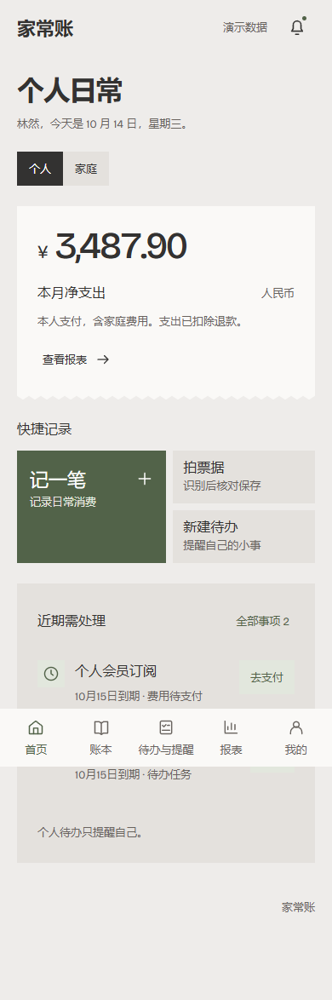

### 12.2 账本

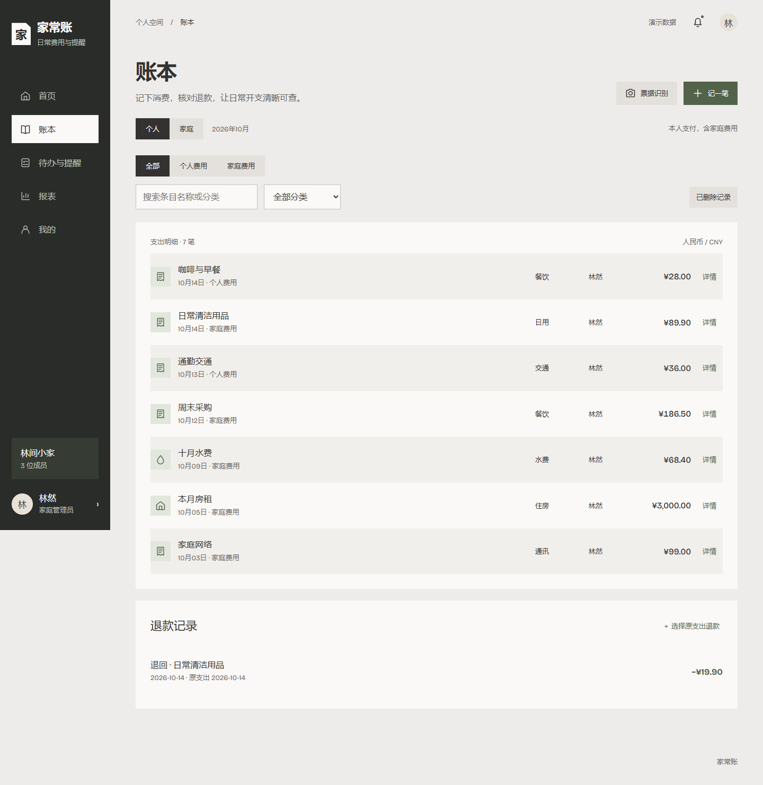

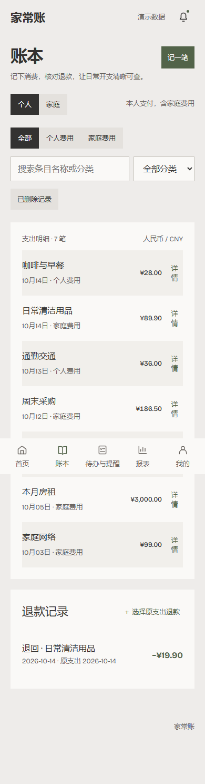

### 12.3 待办与提醒

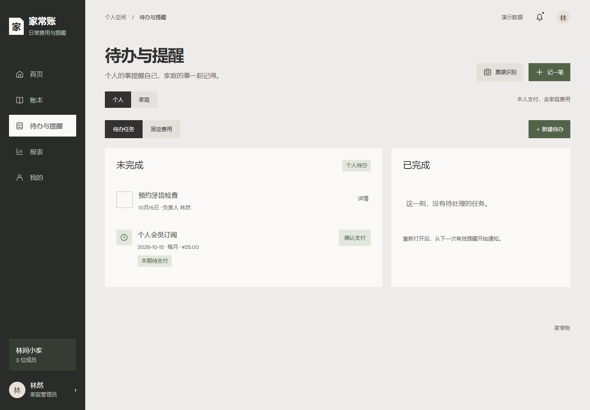


### 12.4 报表

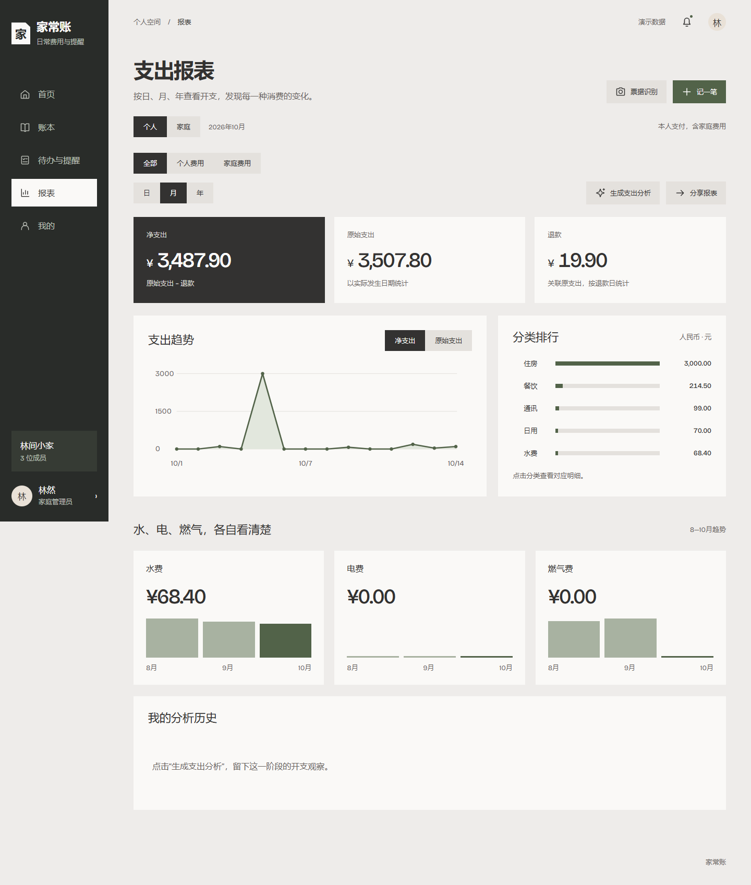

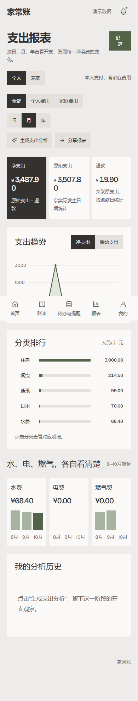

### 12.5 我的与管理入口

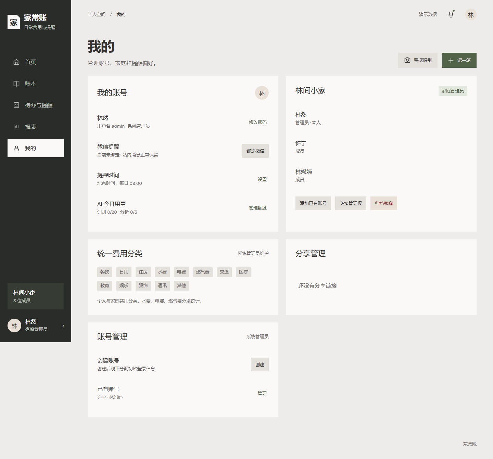

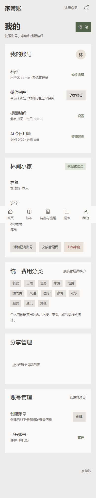

### 12.6 记账表单

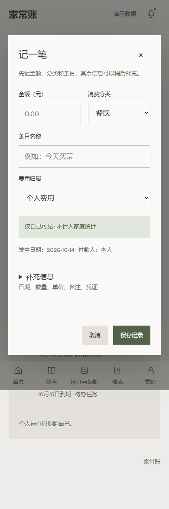

原型源文件在 `prototype/`。从仓库根目录执行 `node prototype/server.cjs` 后访问 `http://127.0.0.1:4173/`，无需安装生产框架。原型数据只在内存，刷新重置；票据与 AI 是示例，不能把可点击演示当作生产接口已完成。打包交付时一并提供该目录，便于核对票据、退款、归档等弹窗流程。

## 13. 开发顺序、命令合同与测试

### 13.1 交付批次

| 批次          | 完成内容                                                               | 通过条件                                               |
| ------------- | ---------------------------------------------------------------------- | ------------------------------------------------------ |
| M0 工程基础   | workspace、版本锁定、数据库迁移、环境校验、契约、日志、Compose开发环境 | 全新环境可安装、构建、迁移、启动；生产缺密钥时明确失败 |
| M1 身份与家庭 | 登录／强制改密、管理账号、成员、权限策略及审计                         | A01—A04、A19—A21，重点无越权与管理员约束               |
| M2 账本与退款 | 支出、退款、回收站、文件访问、统一分类                                 | A05—A11、A25、A33—A34及并发退款测试                    |
| M3 待办与周期 | 普通任务、固定费用、付款事务、持久化提醒                               | A12—A18、重启恢复与并发付款不重复                      |
| M4 报表与分享 | 统一聚合、图表、明细及访客快照                                         | A22—A23、A30—A31，负值及失效权限正确                   |
| M5 AI与票据   | 主动请求、额度、核对、混合隐私、分析证据                               | A26—A29、A35—A37，先假适配器契约测试再真服务样本       |
| M6 发布       | 手机整体验收、通知真通道、备份恢复、部署与回滚演练                     | A24、A32及全部回归，无未经确认替代功能                 |

批次表示实施依赖，不表示首版可在缺少已确认功能时宣称全部完成。真微信渠道在确认后接入，站内与通知端口先开发。

截至 2026-10-15，M0 工程基础与 M1 身份和家庭已实现。M1 提供 admin 首次初始化、用户名密码登录、首次强制改密、会话轮换与撤销、个人昵称修改、系统管理员创建／重置／停用账号、家庭创建、按完整用户名添加成员、移出／退出、管理权交接、归档与恢复；家庭和账号关键变更写入审计。普通访客只会看到登录入口，未登录不能进入应用页。服务端对家庭成员和账号启停使用版本条件写入；生产错误响应不会返回内部异常内容。

M2 账本实现已完成代码并通过当前可用环境的回归：统一分类读取，个人／家庭支出列表、搜索与过滤，支出新增／编辑／软删除／恢复，退款关联原支出、退款累计不超过原金额、退款编辑／软删除／恢复，写操作幂等记录、版本冲突和审计；个人空间默认包含本人付款的家庭费用，家庭查询按成员关系隔离。回收站恢复期限为 30 天，原支出与同批退款一同恢复。账本页已接入原型风格的桌面纸面列表、轻量表单、详情、退款入口与手机单列布局。

票据支持 JPEG／PNG／WebP 签名检查、单张 10 MiB 上限、随机文件名、独立私有存储卷、哈希记录及鉴权内容读取；响应设为 `private, no-store`，不会把存储键返回给客户端。票据默认仅上传者可访问；首次关联家庭费用时可明确授权家庭成员查看，混入个人费用后锁回私有。账本中的“拍票据识别”由用户主动触发：原图先私有上传，识别结果作为待核对草稿；用户选择条目并确认保存后才创建支出。未配置 AI 时不会上传图片或调用模型。上传持久目录通过 `RECEIPT_STORAGE_PATH` 配置，Compose 使用 `/data/receipts` 卷。

M2 验证包括 PGlite HTTP 集成、退款额度与幂等、删除恢复批次、票据文件内容及其他账号拒绝访问，以及桌面／手机账本记账浏览器测试。当前环境没有 Docker、PostgreSQL 服务或 `psql`，PGlite socket 服务限制单个数据库连接，不能用它证明真实并发退款的行锁语义；M2 上线验收前必须在标准 PostgreSQL 18 上补跑两个超额退款并发、相同幂等键并发、家庭归档与记账并发。不得将本地顺序集成通过表述成并发已验收。

M0—M5 当前通过 Monorepo 类型检查、Prettier、服务端单元测试、PGlite 集成测试、web/server 生产构建，以及桌面／手机浏览器端到端测试。2026-10-15 最近一次服务端回归通过单测15项、集成测试14项；浏览器验收10项通过，覆盖个人优先导航、无会话登录入口、访客分享口令查看、个人记账及创建待办。浏览器端测试对 API 使用受控响应，不能替代完整 API＋worker 端到端验收；AI 分析集成测试使用模拟 provider，不调用外部 AI。本地 PGlite 仅用于开发和隔离测试；Prisma PG pool 限制为单连接。Docker 未安装，因此 Compose 镜像构建、正式 PostgreSQL 18 部署、真实并发、备份恢复和回滚演练尚未验收。Windows 本机 pnpm 虚拟依赖链接不完整曾造成测试误报；恢复所需链接后全量集成测试通过。

M3 已实现普通待办的创建／编辑／删除／完成／重开，家庭负责人验证与成员退出／移除／停用时的未完成事项管理权交接；固定费用规则创建／修改／暂停／恢复、每月或每年期次生成、本人确认付款、跳过期次，以及付款支出删除／恢复与期次状态联动。提醒偏好、站内消息列表／已读、家庭全员和个人提醒对象、北京时间扫描器及待办／固定费用页面已接入。2026-10-26 新增 PushPlus 微信推送：每位用户单独绑定 Token，服务端加密保存；后台持久化投递、有限重试，设置页支持测试、开关和解绑。仅推送启用后生成且仍有效的待办／固定费用提醒；推送失败不影响站内消息。PushPlus 接口返回受理不代表微信最终送达，真实 Token、渠道接收、额度及标准 PostgreSQL 并发仍需实测。固定费用新增生效日期快照：规则更新及恢复从下一期生效，停机漏建的活动期次按时间顺序补建，每次扫描最多补120期；扫描事务通过 PostgreSQL 事务级 advisory lock 避免多个 worker 同时处理。M3 尚未完成生产验收：PostgreSQL 18 下 advisory lock、多实例付款与消息投递并发、worker 重启及长时间积压恢复仍须在标准数据库验证。

M4 报表与访客分享已实现：个人报表按本人付款统计，可筛选个人或家庭来源；家庭报表按家庭归属统计并展示付款人排行。周期比较、退款归组、趋势、分类排行和可筛选明细均使用真实服务端数据。分享由服务端生成静态白名单快照，支持1／7／30天期限、可选口令、撤销、限速、30分钟独立访客会话、授权变更失效和到期清理；访客不显示逐笔记录或成员姓名。分享的3项隔离集成测试通过，标准 PostgreSQL 18 查询与并发验收仍待执行。

M5 主动 AI 与票据识别代码已接入：DeepSeek OpenAI 兼容适配器支持票据视觉识别和汇总分析；票据原图仅在用户主动识别时发送，识别草稿需要人工核对并确认才会记入账本；分析请求只发送日期、金额、标准分类与周期汇总，证据金额由服务端绑定。AI 任务持久化、幂等、北京时间额度（识别20次／日、分析5次／日）、预占与失败释放、两次有界尝试、停滞任务恢复及家庭授权校验已实现。无数据时返回确定性结果且不创建 AI 请求。模拟 provider 集成测试覆盖额度、隐私过滤、幂等和证据绑定。当前 `AI_PROVIDER=disabled`，必须由部署者配置 DeepSeek API key 后才会发生真实模型调用；实际票据样本、数据处理条款、费用及准确率验收仍待用户决定并实测。视觉模型默认 `deepseek-flash`，参考[DeepSeek 视觉接口文档](https://api-docs.deepseek.com/guides/vision/)。

M6 发布验收尚未完成：Docker 与标准 PostgreSQL 18 均未在本机安装，因此正式镜像构建、真实数据库并发、备份恢复和回滚演练未执行。PushPlus 已完成代码接入，接收绑定、真实送达及渠道限制仍待验证。桌面与手机的受控浏览器流程已通过，主要功能流程仍需在完整 API＋worker＋数据库环境做最终验收。

开发模式使用 PGlite 时，提醒扫描在 API 进程内运行以复用单连接；`DEV_DATABASE=external` 时 API 不启动内嵌扫描，`pnpm dev` 会同时启动独立 worker。worker 每分钟扫描周期并依靠唯一约束去重，扫描事务使用 advisory lock 协调多实例。M3 当前通过日历计算单测、PGlite 任务／付款／回收站／提醒集成测试和桌面／手机待办表单浏览器测试；暂停恢复和积压补建专项集成测试已补充。PostgreSQL 18 下的 advisory lock、多实例付款／投递并发和长时间积压专项验收仍待执行。

本机依赖已从 pnpm 缓存恢复，Prisma Client 已生成；类型检查、Prettier、服务端单元／集成测试、桌面／手机浏览器测试和生产构建通过。安装未实际下载依赖包，外网依赖下载仍未验证。当前正在运行的本机 API `/health/ready` 返回503，直接 PostgreSQL 查询报 `ECONNRESET`；使用临时内存目录和临时持久目录的新 PGlite socket 均可通过 `SELECT 1`。这说明目前异常集中在既有本机数据库进程或其持久数据状态，不能将当前本机 API 描述为已稳定可用。开发数据库目录含本机数据，需先由用户正常停止 `pnpm dev`（Ctrl+C，待数据库进程退出）后再重启并检查；不得删除 `data/local-postgres` 来绕过问题。

本机开发数据库的初始系统管理员已创建：用户名 `admin`。初始密码由用户设置，因属于登录凭据，不保存在项目文档中；应由用户安全保管，并在首次登录时修改。此账号只存在于本机 `data/local-postgres` 开发数据库，正式部署环境需单独初始化管理员。

### 13.2 项目必须提供的命令

以下是正式工程的 script 合同。M0 已搭建 Monorepo 并实现安装、开发、类型检查、静态检查、单元测试、集成测试、浏览器测试、构建、迁移和分类播种命令；`bootstrap-admin` 随 M1 身份模块交付。

```text
pnpm install --frozen-lockfile     按锁文件安装
pnpm dev                         并行启动 web/API/worker 开发入口
pnpm typecheck                   contracts、web、server 类型检查
pnpm lint                        静态检查
pnpm test                        业务单元测试
pnpm test:integration            使用隔离 PostgreSQL 的集成测试
pnpm test:e2e                    浏览器端到端测试
pnpm build                       contracts、server、web 顺序构建
pnpm db:migrate:dev               开发环境创建迁移
pnpm db:migrate:deploy            仅应用已提交迁移
pnpm db:seed                     幂等初始化统一分类
pnpm bootstrap-admin             交互式创建首个 admin，不回显密码
```

本机执行 `pnpm dev` 时，会启动持久化 PGlite PostgreSQL 兼容数据库、自动应用迁移和分类种子，并并行运行 API 与 Web；数据保存在根目录 `data/local-postgres/`。也可配置 `DEV_DATABASE=external` 使用本机标准 PostgreSQL。PGlite 仅用于本地开发便利和协议集成测试；并发、扩展、迁移发布和生产验收仍须使用标准 PostgreSQL 18。Compose 提供标准 PostgreSQL 18 服务，前后端分别构建和运行。测试数据库与开发／生产分离，启动集成测试时使用独立临时数据库实例，禁止清理业务数据。

首次实现记录（2026-10-15）：Node 24、pnpm 11、Vue 3、Vite 8、NestJS 12、Prisma 7 和 PostgreSQL 18 已固定版本；生产密钥和 AI／微信开关已纳入环境校验，AI 默认为关闭、微信通知默认为关闭。容器镜像已提供配置，但本地开发机没有 Docker 与标准 PostgreSQL，Compose 镜像构建及标准 PostgreSQL 18 专项验收尚未执行。

### 13.3 必测场景与数据

建立系统管理员、家庭A管理员与成员、家庭B成员、无家庭账号、已离家账号、停用账号，以及访客。管理员角色与本人所属家庭分开验证。

并发与恢复：同一期20个并发付款仅一笔有效支出；原金额100元的两个60元退款至多一个成功；同幂等键并发仅一次写入；删旧付款→新付款→恢复旧付款冲突；改密／停用后旧会话立即无效；worker在受理前／受理后／回执前重启分别核验。

补充并发边界：两个系统管理员并发停用彼此仍保留至少一人；删旧付款→跳过本期→恢复旧付款拒绝；离家再入家不恢复已完成旧任务管理权；已发摘要冻结后新增事项不能被标作已包含在旧投递中。

统计与隐私：本人个人50＋家庭150得到个人默认200、个人归属50、家庭150；10月支出11月退款得到11月负值；一笔支出多笔退款不重复汇总支出；混合票据只显示授权条目合计及本人原图；离家后本人历史只读，不能用图片ID或旧分析ID越权；归档时退款与恢复同样拒绝。

日历：1月31→2月末→3月31；2月29年周期；月初、跨年、北京时间零点额度、跨零点AI结算；暂停和真实停机漏生成区别；半月与上月同日序对比。

AI：未点击没有调用；失败释放额度；轮询不扣次数；恶意图片文本和模型输出不能修改账目；模型漏行／合计差异必须可核对；真服务样本覆盖超市长票据、水电燃气账单、付款截图、模糊／倾斜、优惠和退款。

前端：正常／加载／空／失败／无权限／只读／超额／网络重试状态，320／390／768／1440宽度、手机键盘、可访问焦点及减少动态效果。快照过期／撤销／交接／账号恢复后旧链接仍失效。

## 14. 部署实施说明

### 14.1 生产环境合同

首版一台 Linux 云服务器提供 Nginx、API、worker、PostgreSQL；2核4GB为容量验证起点，实际配置待服务器条件和测试确认。镜像可在开发机／CI构建，生产只拉取并运行。数据库不公开5432端口，API不直接公开3000端口，票据不以静态目录公开。

下面是应由正式工程补齐的 Compose 结构，要求可验证配置、依赖健康检查与启动失败行为。`${...}` 是部署时必须填写的环境参数，不是可直接运行的完整交付镜像；当前阶段不创建生产容器。

```yaml
name: homedata
services:
  db:
    image: ${POSTGRES_IMAGE:?set-pinned-postgres-image}
    restart: unless-stopped
    environment:
      POSTGRES_DB: homedata
      POSTGRES_USER: homedata_owner
      POSTGRES_PASSWORD: ${DB_PASSWORD:?set-db-password}
    volumes:
      - pgdata:/var/lib/postgresql
    healthcheck:
      test: ["CMD-SHELL", "pg_isready -U homedata_owner -d homedata"]
      interval: 10s
      timeout: 5s
      retries: 10
  api:
    image: ${SERVER_IMAGE:?set-server-image}
    command: ["node", "dist/main.js"]
    env_file: ./runtime.env
    restart: unless-stopped
    depends_on:
      db:
        condition: service_healthy
    volumes:
      - receipts:/data/receipts
    expose: ["3000"]
  worker:
    image: ${SERVER_IMAGE:?set-server-image}
    command: ["node", "dist/worker.js"]
    env_file: ./runtime.env
    restart: unless-stopped
    depends_on:
      db:
        condition: service_healthy
    volumes:
      - receipts:/data/receipts
  web:
    image: ${WEB_IMAGE:?set-web-image}
    restart: unless-stopped
    ports: ["80:80", "443:443"]
    volumes:
      - ./nginx.conf:/etc/nginx/conf.d/default.conf:ro
      - ./tls:/etc/nginx/tls:ro
    depends_on:
      - api
volumes:
  pgdata:
  receipts:
```

该例以 PostgreSQL 18 系列镜像的目录结构为基线；使用其他大版本须按官方镜像说明核验卷路径，不能随意更换标签复用旧数据目录。API Dockerfile 的构建输出必须对应 `dist/main.js`、`dist/worker.js`；web镜像基于锁定Nginx镜像并复制Vite产物。生产脚本需加入API健康检查、worker心跳、资源限制、日志轮换和容器非root文件权限，不只依赖 depends_on。

镜像初始化的POSTGRES_USER有较高权限，只用于初始化与迁移；初始化脚本另外创建无SUPERUSER／CREATEDB权限的homedata_app角色，API和worker的DATABASE_URL使用该角色，仅授予必要表和序列读写。迁移使用独立ADMIN_DATABASE_URL，不把它配置给长期运行的API／worker。

### 14.2 Nginx 与 HTTP／HTTPS

首阶段允许生产环境通过公网 IP 使用 HTTP，`APP_ORIGIN` 可填写 `http://<服务器IP>:<HTTP_PORT>`。应用仅接受 HTTP IP 来源，不接受 HTTP 域名；HTTP 下登录及访客会话 Cookie 不设置 `Secure`，以兼容浏览器。账号密码、会话和业务数据会以明文经过网络，只适合受限的初期访问，应限制防火墙来源并避免录入真实敏感账目。后续配置域名时再启用 HTTPS 和安全 Cookie。

以下为后续 HTTPS 域名入口示例：

```nginx
server {
    listen 80;
    server_name ledger.example.com;
    return 301 https://$host$request_uri;
}
server {
    listen 443 ssl;
    server_name ledger.example.com;
    ssl_certificate /etc/nginx/tls/fullchain.pem;
    ssl_certificate_key /etc/nginx/tls/privkey.pem;
    root /usr/share/nginx/html;
    client_max_body_size 12m;

    location /api/ {
        proxy_pass http://api:3000;
        proxy_set_header Host $host;
        proxy_set_header X-Forwarded-Proto $scheme;
        proxy_set_header X-Forwarded-For $proxy_add_x_forwarded_for;
        proxy_read_timeout 30s;
        add_header Cache-Control "no-store" always;
    }
    location = /index.html {
        add_header Cache-Control "no-cache" always;
    }
    location / {
        try_files $uri $uri/ /index.html;
    }
}
```

示例域名必须替换为实际域名；证书签发和续期由部署脚本或证书管理工具负责，续期后检查并reload。上线先验证证书可读与Nginx配置。AI通过异步任务返回202，避免把反向代理超时拉长到模型推理时间。上传10MiB业务限制由后端精确校验，代理12MiB留multipart余量；公共分享与私有图片均禁止公共缓存。

反代仅信任实际Nginx来源，不能信任客户端伪造的转发头。正式配置还需安全头、静态哈希资源缓存、分享路由日志token脱敏及证书到期告警；域名／区域相关接入条件在部署前向平台核验。

### 14.3 环境变量清单

| 变量                                                | 说明                                                         |
| --------------------------------------------------- | ------------------------------------------------------------ |
| NODE_ENV、APP_ORIGIN、PORT                          | production、HTTP公网IP来源或HTTPS域名来源、内部3000          |
| DATABASE_URL                                        | 仅容器内数据库连接，包含正确编码的凭证                       |
| ADMIN_DATABASE_URL                                  | 仅一次性初始化／迁移容器使用，不放入API／worker的runtime.env |
| RECEIPT_STORAGE_PATH                                | `/data/receipts`，API/worker一致                             |
| CREDENTIAL_ENCRYPTION_KEY                           | 凭据加密密钥，独立保存备份                                  |
| AI_PROVIDER、AI_BASE_URL                            | `disabled`／`deepseek`及受控服务地址，不由普通用户填写       |
| AI_API_KEY、AI_VISION_MODEL、AI_ANALYSIS_MODEL      | 服务端密钥及分别选择的模型                                   |
| AI_TIMEOUT_MS                                        | 单次模型调用超时，默认90000毫秒                              |
| WECHAT_NOTIFICATIONS_ENABLED                         | 未确认渠道前设为false，站内消息继续运行                      |
| LOG_LEVEL、RELEASE_ID                               | 脱敏日志级别及本次发布标识                                   |

`deploy/.env` 用于镜像与Compose变量替换，`runtime.env` 用于容器应用配置，两个文件都不提交版本库、权限限制给运维账号。`env.example` 只保存字段名及非秘密示例。前端 `VITE_*` 变量中不得有任何私钥、AI key、数据库URL或通知令牌。

### 14.4 首次上线流程

1. 确认服务器架构、系统、公网IP、HTTP端口及AI／微信出站网络；若后续使用域名再配置HTTPS。记录镜像版本、区域、备份位置和运维负责人。
2. 在本地／CI跑类型、单元、集成、E2E与构建，生成带发布号的server和web镜像，校验镜像架构与目标一致。
3. 准备环境文件、持久卷、私有目录权限和证书；执行 `docker compose --env-file .env config --quiet`，避免把展开后的密钥配置打印到日志。
4. `docker compose --env-file .env up -d db`，等待数据库健康。
5. 使用一次性server容器执行 `pnpm db:migrate:deploy` 与 `pnpm db:seed`；运行时镜像必须包含执行已提交迁移所需依赖。迁移失败不得继续启动新版本。
6. 交互运行 `pnpm bootstrap-admin` 创建admin；无默认密码，测试首次改密。
7. `docker compose --env-file .env up -d api worker web`；检查API ready、worker心跳及通过公网IP的HTTP访问。HTTP仅用于受限初期访问，后续域名应配置HTTPS。
8. 按第15节上线检查跑真实记账、权限、提醒及备份恢复；外部服务未通过真通道测试的功能标记未验收。

命令中的正式scripts和镜像由开发阶段交付，本文不假定它们已经存在。首次上线不自动写入原型演示账目。

### 14.5 备份、升级与迁移

建议目标：每日备份、最多丢失24小时数据（RPO≤24h）、4小时内恢复（RTO≤4h）、保留30天；这些是待确认的运维目标，不是已达成保证。独立备份位置未确定前不能完成生产上线验收。

备份必须包含数据库、票据、必要配置及解密凭据的独立安全副本。首版可用短维护窗口取得一致备份：暂停写入API与worker → 数据库逻辑备份 → 复制受保护票据与清单 → 加密并上传独立位置 → 校验 → 恢复服务。仅拷贝运行中的pgdata目录不算合格备份。备份清单记录版本、时间、文件校验值和恢复步骤；与业务删除周期相关的备份保留须在运维政策说明。

升级：维护前备份 → 使用向后兼容迁移 → 升级API/worker/web → 验证。回滚优先回退兼容旧schema的镜像；不自动执行破坏性down迁移。不可逆结构变更必须另制恢复与数据损失说明。

迁移飞牛NAS：核对CPU架构与内存 → 构建对应架构镜像 → 恢复数据库／票据／配置／密钥 → 测试内网 → 只启动一个生产worker → 切换域名／入口 → 真提醒验证。不可同时运行云端和NAS两套独立生产数据库发送同一家庭提醒。

## 15. 验收追踪与上线闸门

完整A01—A37来自已确认需求，编号不重定义；下表帮助开发定位实现范围。

| 验收编号 | 开发实现与检查                                             |
| -------- | ---------------------------------------------------------- |
| A01—A04  | 账号、首次改密、会话撤销、家庭隔离及访客边界               |
| A05—A11  | 本人付款、金额、退款、删除恢复、凭证及统一分类             |
| A12—A18  | 家庭任务全员提醒、日历周期、并发付款、暂停与可靠投递       |
| A19—A21  | 离家只读、接管、管理员交接、归档冻结与分享失效             |
| A22—A23  | 日期口径、跨月退款、负数、同进度比较、空数据               |
| A24—A25  | 手机全流程、键盘、网络失败保留输入及幂等重试               |
| A26—A29  | 主动AI、私有草稿与混合原图、分析白名单、每日额度           |
| A30—A31  | 固定快照、期限／口令、权限失效及清理                       |
| A32      | R01—R04交叉边界，尤其停用接管与归档恢复                    |
| A33—A37  | 轻量表单、个人付款口径、票据核对／分组、操作者和证据型分析 |

上线必须满足：无跨家庭／个人越权；无并发重复有效付款或超额退款；迁移与全量回归通过；来源配置与密钥保护完成；数据库不公网暴露；worker重启恢复和时区正确；真实备份恢复成功；手机主要流程通过；AI真实样本与费用已记录；微信若纳入首版承诺则真绑定、真投递及受限行为通过。首阶段按公网IP使用HTTP时，账号密码和会话信息未加密传输，应限制访问来源并避免录入真实敏感账目；正式域名入口应启用HTTPS。若外部条件不满足，回到聊天确认范围，不默默替换已确认功能。

监控至少覆盖：API错误率、登录失败异常、磁盘容量、数据库连接与备份新鲜度、worker最近心跳、最老待处理job、失败／未知投递、AI失败与费用、证书到期。日志携带requestId、jobId、releaseId，不记录密码、Cookie、原图、share明文token或完整私人账目。

## 16. 待确认项、资料与交付边界

| 项目                           | 当前结论                         | 何时必须解决                   |
| ------------------------------ | -------------------------------- | ------------------------------ |
| 具体技术组合确认               | 本文采用主推基线，Monorepo已确认 | 正式搭建前                     |
| 微信渠道                       | 暂无公众号，第三方为候选         | 供应商适配器实施前；站内不受阻 |
| 第三方实名／额度与最小外发摘要 | 未收到明确答案                   | 绑定和真实投递前               |
| 云服务器／域名／区域／配置     | 优先云，具体未提供               | 生产部署前                     |
| 独立备份位置、RPO/RTO与保留期  | 本文给出建议目标                 | 生产上线前                     |
| DeepSeek真实调用与数据处理条款 | 偏好已知，尚未实际接通           | 真AI验收前                     |

以上问题在聊天中回答，文档记录结论。环境项未确定不妨碍阅读本文并实现业务、端口与本地验证；涉及外部服务和生产部署时，不把配置占位、mock或供应商文档能力当作实际验收结果。

项目资料：`docs/家庭收支与待办软件-需求设计.md`（完整规则与A01—A37）、`docs/原型设计-第一轮.md`（交互演进）、`docs/UI设计方案-账页版.md`（视觉细节）、`prototype/`（可交互参考）。冲突优先采用最新明确用户决策和已确认规则，未解决差异在聊天确认后同步更新本文件。

官方技术依据（查阅日期2026-10-15；架构与参数选择为项目设计约定）：

- [Vue TypeScript 工具链](https://cn.vuejs.org/guide/typescript/overview)
- [Node.js 支持版本](https://nodejs.org/en/about/previous-releases)
- [NestJS 定时任务](https://docs.nestjs.com/application/task-scheduling)
- [PostgreSQL 版本支持](https://www.postgresql.org/support/versioning/)
- [PostgreSQL 锁机制](https://www.postgresql.org/docs/current/explicit-locking.html)
- [Prisma 事务](https://www.prisma.io/docs/orm/fundamentals/transactions)
- [ECharts 按需导入](https://echarts.apache.org/handbook/en/basics/import/)
- [Docker Compose 启动依赖](https://docs.docker.com/compose/how-tos/startup-order/)
- [PostgreSQL 官方容器镜像与目录](https://hub.docker.com/_/postgres)
- [DeepSeek 图片输入](https://api-docs.deepseek.com/guides/vision/)、[模型及计费](https://api-docs.deepseek.com/quick_start/pricing/)
- [PushPlus 发送限制](https://www.pushplus.plus/doc/help/limit.html)（候选服务，不代表已选定）
- [OWASP 会话管理](https://cheatsheetseries.owasp.org/cheatsheets/Session_Management_Cheat_Sheet.html)、[密码存储](https://cheatsheetseries.owasp.org/cheatsheets/Password_Storage_Cheat_Sheet.html)

## 附录 A. 完整功能验收清单

以下清单沿用已确认需求编号；本清单是后续实现的验收要求，不代表目前已通过生产验收。

| 编号 | 场景与预期结果                                                                                                   |
| ---- | ---------------------------------------------------------------------------------------------------------------- |
| A01  | 首个系统管理员以用户名 admin 建立；所有用户名唯一，初次登录强制改密。                                            |
| A02  | 重置或停用后已有登录失效；管理员看不到当前密码，至少保留一个有效系统管理员。                                     |
| A03  | 管理员完整用户名添加已有账号，已有家庭账号不能同时加入另一家庭，无自助注册、邀请链接和全量账号浏览。             |
| A04  | 不同家庭相互隔离，个人记录对其他成员和管理员不可见；访客无法进入内部页面。                                       |
| A05  | 记账不允许选择他人为付款人，个人／家庭混合消费拆分，家庭账不重复累计。                                           |
| A06  | 本人个人 50 元、家庭 150 元：个人默认 200 元，个人归属 50 元，家庭报表 150 元。                                  |
| A07  | 正支出两位小数，可选数量单位和单价，手调总额后按确认金额统计。                                                   |
| A08  | 退款必须选原支出，归属分类跟随；累计不超原金额，原金额修改不得低于累计退款。                                     |
| A09  | 原支出及关联退款一起删除或恢复，删除即时移出统计，30 天内仅有权本人恢复。                                        |
| A10  | 共用图片不因一笔删除而误删；最后关联记录恢复期满清理，草稿过期不删正式凭证。                                     |
| A11  | 系统统一分类、仅系统管理员维护，停用不丢历史，水电燃气各自查看趋势。                                             |
| A12  | 个人待办仅本人提醒，家庭待办所有当前成员提醒；一人完成全家完成，重开不立即重复推送。                             |
| A13  | 截止日期日终逾期；默认 9 点、提前天数和逾期每日规则准确生效。                                                    |
| A14  | 固定费用首次提前提醒生成事项，未支付不入账，月末及闰年日期正确回落。                                             |
| A15  | 预计金额可空、支付金额必填；确认人即付款人，同期并发或重复操作仅一笔有效付款。                                   |
| A16  | 周期变更不改已生成事项，暂停不生成，恢复不补暂停期，跳过不记账。                                                 |
| A17  | 删除或恢复误记付款联动本期状态，有新付款不能恢复旧付款；全额退款不自动重开本期。                                 |
| A18  | 同人同时合并摘要但不漏成员，失败不误报成功，有限重试不重复消息，新成员不收加入前历史提醒。                       |
| A19  | 成员离开保留家庭历史和本人只读费用凭证，失去其他数据及原家庭分析访问，未完成任务按交接规则处理。                 |
| A20  | 最后家庭管理员不可退出留下无人管理家庭，管理员停用前先交接。                                                     |
| A21  | 归档停止提醒和分享，冻结全部家庭写入，个人入口不能绕过；恢复不复活旧链接。                                       |
| A22  | 报表支出减退款等于净支出，日月年明细一致，跨月退款归实际日期，负值真实显示。                                     |
| A23  | 未结束周期同进度比较，空数据为空状态，零基数不显示增长百分比。                                                   |
| A24  | 手机浏览器完成登录、记账、拍照或上传、核对、处理待办及查看报表，键盘不遮挡主要操作。                             |
| A25  | 保存网络失败保留当前输入，重试不重复生成记录，无离线保存或导入导出入口。                                         |
| A26  | 没有主动操作不调用 AI，草稿不入统计，识别不确定／金额差异／重复均按核对规则处理。                                |
| A27  | 限单张 JPG／PNG／WebP、10 MB；草稿 7 天，混合原图私有，纯家庭图片按成员权限共享。                                |
| A28  | 分析只发当前空间统计白名单，无姓名、备注、商家条目或票据，结果私有且不会自动分享。                               |
| A29  | 额度默认 20／5，失败不扣、附带分类合计一次、单独分类计识别一次、查看不计、零点重置；超额不影响普通功能。         |
| A30  | 访客只读汇总快照，期限 1／7／30 天默认 7，口令可选，过期撤销或权限丧失后立即不可访问。                           |
| A31  | 失效快照仅有权管理者可查看，保留 30 天清理，恢复权限不复活原链接。                                               |
| A32  | R01—R04 对应账号停用任务接管、归档恢复、退款跟随规则均纳入验收。                                                 |
| A33  | 记账首屏突出金额、分类、名称，可展开补充字段；归属与可见性始终明确；再记及短暂撤销可用。                         |
| A34  | 个人报表标明本人付款含家庭费用；保存家庭费用前说明家庭成员可见且计入家庭统计。                                   |
| A35  | 票据汇总与展开明细、批量和单项归属、成组展示可用；补充已有凭证不重复生成支出或改变原金额，分组不泄露不可见条目。 |
| A36  | 完成者、付款人和简短操作历史可追溯；不扩大管理员修改他人账目的权限。                                             |
| A37  | 分析展示可计算的变化、证据范围与待核对问题；可查看明细，数据不足不归因；水电燃气无专用输入。                     |
