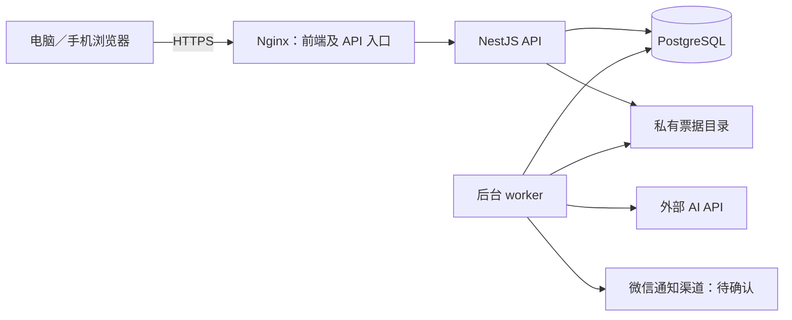

# 家常账项目技术路线

版本：0.2（已确认同仓结构；技术组件为主推基线）  
日期：2026-10-15  
阶段：技术路线设计；第一版 UI 与交互原型已确认，正式开发未开始。

## 1. 已确认条件

- 优先部署云服务器，提供外网访问；飞牛 NAS 作为后续可迁移目标。
- 用户已确认一个 Monorepo：apps/web 前端、apps/server 后端、packages/contracts 共用接口契约，前后端独立构建运行、统一部署。
- 暂无微信公众号。
- AI 服务偏向 DeepSeek 一类的外部 API，不要求在服务器本地运行模型。
- 电脑与手机使用同一套响应式 Web，沿用已确认的账页版 UI。
- 功能、权限及数据口径以《家庭收支与待办软件-需求设计》1.2 为准。

详细开发设计、接口、数据模型、流程与原型图统一见《家常账-开发技术文档》1.0。

## 2. 主推技术组合

下表为技术建议，尚未代表用户确认。

| 层次 | 建议选择 | 目的 |
| --- | --- | --- |
| 前端 | Vue 3、TypeScript、Vite、Vue Router、Pinia | 实现五个页签、响应式表单与个人／家庭空间切换 |
| UI | 自有设计变量与业务组件、CSS；基础交互组件按可访问性需要选用 | 保持已确认视觉，统一弹窗、抽屉、表单及键盘交互 |
| 图表 | Apache ECharts，按需加载 | 日月年趋势、分类及成员付款图表，移动端适配 |
| 服务端 | Node.js、TypeScript、NestJS，REST API | 统一执行权限、账务、家庭和任务规则 |
| 数据库 | PostgreSQL | 事务、外键与唯一约束，保证退款、固定费用付款等数据一致性 |
| 数据访问 | Prisma，复杂统计和锁定使用参数化 SQL | 数据模型、迁移、日常访问及事务；不强行把全部报表转成 ORM 查询 |
| 登录 | 数据库会话、HttpOnly/Secure Cookie、密码哈希 | 支持停用及重置密码后立即撤销会话；同域部署并校验写入请求来源及 CSRF |
| 图片 | 私有持久化目录，经过后端鉴权读取 | 首版减少存储服务；保留可替换存储接口，以后接对象存储 |
| 后台任务 | 同一后端工程中的独立 worker 进程、数据库任务表及发送记录 | 固定费用生成、提醒、清理、AI 请求；重启后可恢复 |
| AI | 服务端统一供应商接口，DeepSeek 优先候选 | 票据提取与分析可分别配置模型，避免接口密钥进入浏览器 |
| 通知 | 站内消息必备；微信外部渠道待确认 | 保留通知记录，展示未绑定、失败及外部渠道受限状态 |
| 部署 | Linux 云服务器、Docker Compose、Nginx、HTTPS | 同域提供前端及 API，持久化数据库和图片，便于备份与迁移 |
| 验证 | 类型检查、业务单元测试、真实 PostgreSQL 集成测试、Playwright | 重点验证权限、并发付款／退款、提醒和手机主要流程 |

版本策略：正式搭建时核验兼容性，选择仍受支持的稳定版本和 Node.js LTS，并在锁文件、镜像及部署说明中固定版本；本稿不预先指定未经组合验证的最新版本。

## 3. 选择理由与边界

项目的主要难点是权限、账务一致性和可靠提醒。采用前后端分离的模块化单体：一个后端工程负责业务，API 与 worker 分开运行并共享业务服务和数据库。前端主要是登录后的应用页面，访客也只是受限快照，不依赖搜索引擎收录；当前不需要引入服务端页面渲染。

Vue 与 NestJS 统一使用 TypeScript，减少跨语言维护成本。后端仍独立验证全部输入和权限，前端隐藏按钮不构成授权。

首版不引入微服务、Kubernetes、Redis、独立消息中间件或本地大模型。数据库承担持久化任务与限额记账；外部 AI 执行期间不长时间持有数据库事务。出现经过测量的吞吐或运维需求后再扩展。

临时原型继续用于核对视觉和交互，正式业务逻辑重新实现。组件拆分、接口和数据模型不得照搬原型的内存状态。

## 4. 部署与迁移

- 云服务器为首个生产环境；只有反向代理公开提供 Web 服务，数据库和票据目录不直接暴露到公网。
- 先按少量家庭、低并发估算，2 核 4 GB 内存可作为容量验证起点，不构成性能保证；正式配置需结合现有服务器、构建位置和实测确定。
- 镜像构建与应用运行可分开，避免小服务器构建期间占满资源。
- 数据库、票据、配置与存储加密所需密钥均纳入恢复方案。建议每日加密备份至独立位置，保留周期及恢复时限待确认；上线前必须做恢复演练。
- 迁移 NAS 时迁移数据库、私有文件及配置，不复制运行中的数据库目录作为备份。需核对 NAS CPU 架构、内存、容器能力和外网接入；暂不承诺未经验证的一键迁移。
- 首版单服务器存在维护或故障停机窗口；后台任务恢复不代表外部消息可保证即时送达。

费用分为云服务器与磁盘、域名、独立备份空间、AI 用量和可选通知渠道。云厂商、区域及套餐未定，当前不提供月费报价；选定后同时记录首购、续费及按量费用。

## 5. 数据与业务可靠性

- 金额按人民币分存整数，API 金额字段使用明确约定的十进制字符串，避免浮点累计误差；数量、单价使用定点小数。实付金额是统计依据，数量与单价不自动覆盖票据实付。
- 消费及退款归属使用北京时间业务日期；系统事件存时间戳，周期和提醒按 Asia/Shanghai 计算。
- 退款与原支出关联；并发退款时锁定原记录并在事务内核验累计退款，禁止越额。
- 固定费用规则和每期任务分开；周期标识唯一，确保每期最多一笔有效付款。误记删除、恢复及新付款之间的冲突在事务内处理。
- 每次写入执行账号状态、家庭关系、角色、归属和归档状态检查；请求范围不是可信身份来源。
- 管理员交接、停用、离家和归档操作使用事务并使相关会话、分享与待处理通知按规则失效；本人历史只读入口单独授权。
- 保存使用幂等键防止网络重试重复记账。操作日志与业务数据共同提交。
- 票据目录不公开；文件类型、字节大小、图像尺寸及解码结果均在服务端验证。混合票据原图始终私有，购物分组仅汇总当前有权查看的条目。
- 访客快照是独立汇总数据，访问时仍检查有效期、撤销和分享者当前权限；不能只靠静态文件或前端判断。

提醒按数据库中的到期状态扫描生成，每分钟轮询可作为初始实现。任务带唯一标识、重试次数、下次执行时间及执行租约；worker 重启后恢复待处理任务，执行前重新检查完成、成员和归档状态。固定费用暂停后不补建历史周期，断线补偿遵循已确认提醒规则。

站内消息与外部发送任务在事务中一起落库。外部请求不在该事务内执行，发送按用户和时点合并、限速，并查询渠道最终结果。若渠道缺少幂等能力，网络超时存在“实际送达但未获回执”的不确定性，需查询后再决定重试，不能宣称跨平台绝对不重复或必达。

## 6. DeepSeek 接入建议

截至 2026-10-15，DeepSeek 官方文档列出的 `deepseek-flash` 支持图片输入；不能沿用“DeepSeek API 一律不支持图片”的旧判断。图片能力与账单字段准确率是两件事，接入前仍需验证。依据：[视觉输入文档](https://api-docs.deepseek.com/guides/vision/)、[模型与计费说明](https://api-docs.deepseek.com/quick_start/pricing/)。

建议先评估 DeepSeek 同时承担票据提取、分类建议和文本分析。保留独立 OCR／其他视觉供应商接口，只有样本验证显示必要时才引入第二家服务，不自动把用户票据转发给未告知的供应商。

票据流程：用户主动识别 → 服务端校验图片 → 外部模型提取结构化字段 → 校验类别、金额、数量与合计差异 → 用户核对 → 显式保存。图片不通过永久公开链接提供给模型。模型输出是不可信输入，不直接操作账本。

分析流程：数据库计算已授权范围的指标 → 仅发送既定汇总白名单 → 模型生成说明 → 校验关键数值及证据引用 → 私有保存。确定性计算由程序完成，用户不点击不调用。

账户额度采用预占、成功结算及失败释放，重试关联同一业务请求；供应商可能对失败请求产生费用，这与产品“失败不扣用户次数”分开记录。另设系统请求并发、输出长度和费用保护，阈值在接入实测后确认。

验收样本至少包含超市长票据、水电燃气账单、付款截图、模糊／倾斜照片及含退款／优惠的单据；检查字段准确率、漏行、合计差异、耗时、实际费用和失败重试。未完成真实调用前，不把文档可用等同于本项目接入已验证。

## 7. 微信提醒路线

目前没有自有公众号。微信官方模板消息页面本次未能读取，因此自有公众号的当前申请资质、可用模板及推送限制仍需从官方渠道或后台核验，暂不作为已具备条件。

建议评估第三方微信推送服务，PushPlus 为候选。其官方说明支持微信通知；当前文档要求发送方实名，普通实名账户微信渠道每日请求额度 200 次、每分钟 5 次，同内容亦有限制。接口请求成功不代表最终送达，需要回执或查询结果。依据：[服务介绍](https://www.pushplus.plus/doc/)、[接口限制](https://www.pushplus.plus/doc/help/limit.html)。这些是供应商当前规则，不是本系统保证。

若接受该候选，每个账号绑定自己的接收渠道；家庭事项仍由系统根据当前成员逐人生成通知，不通过固定群组替代家庭权限。离家、停用和归档时重新核对待发消息。接收人绑定、解绑及最终投递须实测。

建议外部通知只发送“有 N 项事项待处理”等最小摘要及需要登录的应用入口，具体事项留在站内查看；第三方仍会处理发送时间、摘要和接收标识。通知服务令牌仅在服务端加密保存，不能进入分享链接、日志或前端代码。

是否使用第三方服务、是否接受实名与额度约束，以及上述外部通知摘要策略，均待用户确认。不绑定或渠道受限时保留站内提醒，界面如实显示外部通知状态。

## 8. 待确认与接入核验

| 编号 | 内容 | 当前状态 |
| --- | --- | --- |
| T01 | 云服务器优先、保留 NAS 迁移能力 | 用户已确认 |
| T02 | 暂无公众号，AI 偏向 DeepSeek 类 API | 用户已说明 |
| T03 | 本文 Vue／NestJS／PostgreSQL 等主推组合 | 建议稿待确认 |
| T04 | 是否接受第三方微信通知、实名／额度及最小摘要 | 待聊天确认 |
| T05 | 云服务器是否已有、区域／配置、域名情况 | 待聊天确认 |
| T06 | 独立备份位置、保留周期和恢复目标 | 部署方案中确认 |
| T07 | DeepSeek 真实票据测试、权限、费用及输出稳定性 | 有接入配置后核验 |
| T08 | 微信接收绑定、当前限制及最终回执 | 通知路线确认后核验 |

当前阶段不创建正式项目、不购买服务器、不注册公众号、不发送消息、不调用付费模型。先在聊天中解决路线问题，文档只记录结论。

## 9. 官方技术依据

以下文档于 2026-10-15 查阅，支持组件能力说明；整体架构选择是结合项目需求作出的建议。

- [Vue TypeScript 与 Vite 工具链](https://cn.vuejs.org/guide/typescript/overview)
- [NestJS 定时任务](https://docs.nestjs.com/application/task-scheduling)
- [PostgreSQL 显式锁](https://www.postgresql.org/docs/current/explicit-locking.html)
- [Prisma 事务](https://www.prisma.io/docs/orm/fundamentals/transactions)
- [ECharts 按需加载](https://echarts.apache.org/handbook/en/basics/import/)
- [Docker Compose](https://docs.docker.com/compose/)
